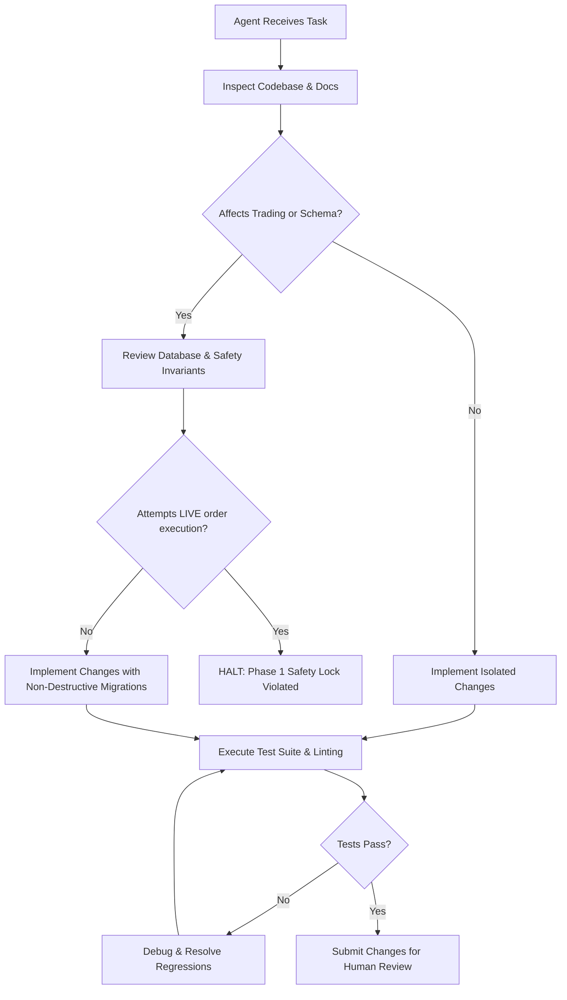

# Operating Instructions for AI Agents & Engineers (AGENTS.md)

> [!IMPORTANT]
> This document defines the non-negotiable operational rules, architectural boundaries, and safety constraints governing all human engineers and autonomous AI agents contributing to the **NIFTY Auto Trader 3.0** codebase.

---

## 1. Prime Directives

Every contributor, whether human or AI agent, must adhere strictly to the following eight prime directives:

### 1.1 Always Inspect Before Modifying
- **Never make blind assumptions** about existing schema fields, endpoint signatures, or model attributes.
- Always inspect the live file tree, inspect existing data contracts in [packages/api-contracts/src/index.ts](file:///d:/Coding/Auto%20Trader%203.0/packages/api-contracts/src/index.ts), and inspect backend models in [services/api/app/models/enums.py](file:///d:/Coding/Auto%20Trader%203.0/services/api/app/models/enums.py) before authoring changes.
- Check configuration flags in [.env.example](file:///d:/Coding/Auto%20Trader%203.0/.env.example) and [services/api/app/config.py](file:///d:/Coding/Auto%20Trader%203.0/services/api/app/config.py).

### 1.2 Strictly Preserve Backwards Compatibility
- Never introduce breaking changes to existing REST endpoints (`/api/v1/*`) or data envelope types (`ApiResponse<T>`).
- Database schema alterations must be additive (new columns must be nullable or possess defaults).
- Deprecated fields must remain supported with backward-compatibility shims until a major version cut.

### 1.3 Never Create Duplicate Routes, Schemas, Models, or Clients
- The shared contract package [packages/api-contracts](file:///d:/Coding/Auto%20Trader%203.0/packages/api-contracts) is the single source of truth for all API definitions, response payloads, enums, and request contracts.
- Frontend Next.js code must import types from `@autotrader/api-contracts`.
- Backend FastAPI models in [services/api/app](file:///d:/Coding/Auto%20Trader%203.0/services/api/app) must mirror `@autotrader/api-contracts` precisely.
- Do not create shadow client libraries or duplicate enum definitions.

### 1.4 The Backend is Authoritative
- The browser frontend ([apps/web](file:///d:/Coding/Auto%20Trader%203.0/apps/web)) is strictly a **passive presentation and control dashboard**.
- **No trading calculations, state transitions, risk checks, or position valuations may execute in the client.**
- All position P&L calculations, capital allocation checks, strategy evaluation routines, and trade cycles are calculated authoritatively by FastAPI backend services and the Trading Worker.

### 1.5 Zero Mock Financial Data in Production/Runtime
- **Synthetic or mock financial data is prohibited** outside of unit and integration test fixtures.
- If the broker is disconnected, unconfigured, or returns an error, the system must report `BrokerConnectionState.NOT_CONFIGURED` or `BrokerConnectionState.DISCONNECTED` with `DataFreshness.UNAVAILABLE`.
- UI components must display truthful empty states (`"Not Available"`, `"No Data"`, `"Broker Disconnected"`). Never fabricate dummy P&L numbers, mock orders, or artificial strike prices.

### 1.6 Safe Database Migrations
- **Never drop tables, truncate financial records, or remove columns in production** without explicit human confirmation.
- All database modifications must be managed via version-controlled Alembic migrations under [services/api/alembic](file:///d:/Coding/Auto%20Trader%203.0/services/api/alembic).
- Migrations must support bidirectional execution (`upgrade` and `downgrade`) and undergo dry-run validation against PostgreSQL before deployment.

### 1.7 Mandatory Verification and Regression Checks
- After editing any code, execute the appropriate test suites and type checkers:
  - Frontend: `npm run type-check:web` and `npm run test:web`
  - Contracts: `npm run contracts:check`
  - Backend: `pytest` in `services/api`
  - Worker: `pytest` in `services/trading_worker`
- Verify that no orphan tasks or unhandled exceptions are generated.

### 1.8 Strict Phase Boundary Awareness
- **Phase 1 Scope**: Read-only foundation, account telemetry, real-time market quote ingestion, strategy validation, and safe monitoring dashboard.
- **Phase 1 Hard Lock**: **Under no circumstances may an agent implement live broker order submission (`place_order`, `modify_order`, `cancel_order`) in Phase 1.**
- Attempting to bypass the safety lock in [services/trading_worker/worker/engine.py](file:///d:/Coding/Auto%20Trader%203.0/services/trading_worker/worker/engine.py) (`LIVE` mode lock) without explicit Phase 2 authorization is considered a critical safety breach.

---

## 2. Monorepo Structure & Organization

```
d:\Coding\Auto Trader 3.0\
├── apps/
│   └── web/                   # Next.js 14+ App Router dashboard
├── packages/
│   ├── api-contracts/         # Shared TypeScript interfaces, enums, & API routes
│   └── ui-tokens/             # Shared styling, colors, financial tokens, labels
├── services/
│   ├── api/                   # FastAPI backend server (HTTP/REST gateway)
│   └── trading_worker/        # Autonomous Python worker (state machine & runner)
├── infrastructure/
│   ├── docker/                # Dockerfile and docker-compose configurations
│   └── deployment/            # VPS static-IP deployment scripts and systemd units
├── tests/
│   ├── api/                   # FastAPI endpoint & integration tests
│   ├── web/                   # Frontend unit and component tests
│   ├── integration/           # Cross-service end-to-end integration tests
│   └── e2e/                   # Full browser end-to-end test scenarios
├── docs/                      # Architectural and technical documentation suite
├── AGENTS.md                  # This file (Agent operating instructions)
├── README.md                  # Developer quickstart and project overview
└── package.json               # Monorepo workspace configuration
```

---

## 3. Coding Standards & Conventions

### 3.1 TypeScript & Frontend Guidelines
- Strict TypeScript mode enabled across all packages (`"strict": true` in [tsconfig.json](file:///d:/Coding/Auto%20Trader%203.0/packages/api-contracts/tsconfig.json)).
- Absolute imports utilizing path aliases defined in package configs.
- Functional components with React hooks; avoid untyped `any` or loose casting (`as unknown as T`).
- UI styling must leverage tokens defined in [packages/ui-tokens/src/index.ts](file:///d:/Coding/Auto%20Trader%203.0/packages/ui-tokens/src/index.ts). Avoid hardcoding hex colors or pixel sizes directly in JSX.

### 3.2 Python & Backend Guidelines
- Python 3.11+ using standard type hinting (`typing` module / PEP 585 / PEP 604 union types `X | Y`).
- Pydantic v2 schemas for all request validation and response serialization.
- Async I/O throughout FastAPI route handlers and database queries (`async def`, `asyncpg`, `AsyncSession`).
- Decimal representation for all financial values (`Decimal` in Python, serialized as strings in JSON payloads to preserve 4-decimal precision). Never use floating point numbers for currency or pricing calculations.
- Centralized datetime handling: All timestamps stored in database and transmitted across APIs must be timezone-aware **UTC ISO 8601 strings** (`YYYY-MM-DDTHH:mm:ss.sssZ`). Display conversion to Indian Standard Time (`Asia/Kolkata`, IST = UTC+5:30) occurs strictly at the presentation boundary.

### 3.3 Financial Calculations & Invariants
```python
# Invariant: Quantities must be integer multiples of the exchange lot size (e.g., 25 or 50 for NIFTY)
assert quantity % lot_size == 0, "Order quantity must be a multiple of lot size"

# Invariant: Prices must conform to tick size increments (0.05 for NSE equity & options)
from decimal import Decimal
TICK_SIZE = Decimal("0.05")
assert (price % TICK_SIZE) == Decimal("0.00"), f"Price {price} is not aligned to tick size {TICK_SIZE}"
```

---

## 4. Operational Safety Protocol



> [!CAUTION]
> If an agent encounters a database migration failure, corrupted state, or unknown broker error, it must immediately transition the system into `EngineState.ERROR` or `EngineState.RISK_LOCKED` and log a high-severity `SystemEvent`. Do not attempt unsafe automatic recovery that risks financial exposure.
