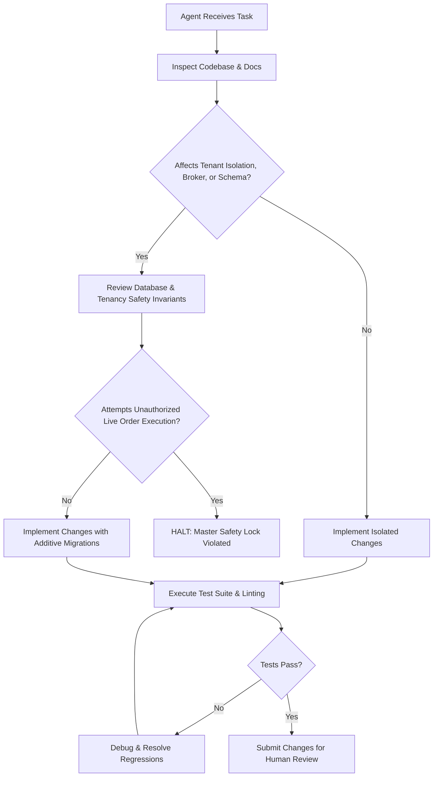

# Operating Instructions for AI Agents & Engineers (AGENTS.md)
## NIFTY Auto Trader 3.0 — Multi-Tenant, Multi-Broker Trading SaaS

> [!IMPORTANT]
> This document defines the non-negotiable operational rules, architectural boundaries, and safety constraints governing all human engineers and autonomous AI agents contributing to the **NIFTY Auto Trader 3.0** Multi-Tenant, Multi-Broker Trading SaaS platform.

---

## 1. Master Development Contract — 25 Non-Negotiable Rules

Every contributor, whether human or AI agent, must adhere strictly to the following 25 non-negotiable rules:

1. **Inspect Before Modifying**: Inspect the entire existing repository, schemas, and API contracts before authoring changes. Never make blind assumptions.
2. **Preserve Existing Functionality**: Preserve existing working functionality, database records, and user preferences. Backward compatibility is strictly mandatory.
3. **Never Blindly Rewrite**: Never blindly rewrite the entire project or overwrite existing configuration.
4. **Dedicated Feature Branches**: Create and work on a feature branch (`feat/*` or `fix/*`). Never push directly to `main` without review. Never force-push.
5. **Canonical Services**: Maintain one canonical service and API contract for each business responsibility.
6. **Zero Duplication**: Do not introduce duplicate components, pages, database tables, authentication systems, broker clients, or trading engines.
7. **Safe Database Migrations**: Use version-controlled Alembic database migrations for schema alterations. All migrations must be additive and reversible (`upgrade` and `downgrade`).
8. **Tenant Ownership Invariant**: Treat every trading entity (accounts, orders, positions, trades, strategies, alerts) as belonging to an authenticated, authorized tenant/user.
9. **Backend-Enforced Tenant Isolation**: Enforce tenant isolation authoritatively on the backend and database layer, not merely in frontend presentation filters.
10. **Zero Cross-Tenant Leakage**: Never mix one trader's broker tokens, funds, positions, strategy settings, orders, or trade history with another user's.
11. **Decimal-Safe Financial Calculations**: Use decimal-safe financial calculations (`Decimal` / `NUMERIC(15, 4)`) and immutable broker execution records. Never use floating-point numbers for currency.
12. **Zero Mock Financial Data in Production/Runtime**: Never generate synthetic or mock live trades, balances, quotes, orders, broker connections, or P&L outside of automated unit test fixtures.
13. **Validated Database Settings**: Put configurable trading values in validated, versioned database settings with immutable audit trails.
14. **Centralized Design System**: Centralize UI design tokens, typography, status labels, and API schemas in shared packages (`@autotrader/api-contracts`, `@autotrader/ui-tokens`).
15. **Standardized Typography**: Use **Inter** as the primary font family throughout the application, a professional light theme by default, and an optional dark theme.
16. **Accessible & Responsive**: Ensure all pages and components are fully accessible and responsive across desktop, tablet, and mobile breakpoints.
17. **Auditing & Idempotency**: Implement secure auditing, authorization, client order idempotency (`tenant_id:client_order_id`), and broker order reconciliation.
18. **Credential & 2FA Compliance**: Do not collect or store users' broker passwords, MPINs, or TOTP seeds unless a broker explicitly authorizes and required compliance/security reviews are complete. Prefer broker-hosted OAuth/interactive authorization flows.
19. **Broker Capability Matrix**: Do not assume all brokers support the same products, order types, sessions, market feeds, or fees. Adhere to the canonical Broker Capability Matrix.
20. **Static IP Isolation**: Never route unrelated traders' order flow through one shared static IP unless that exact operating model is formally permitted by relevant broker/exchange arrangements.
21. **Execution Safety Gate**: Keep live order placement and automated execution disabled until explicit permission, compliance, and release gates have passed.
22. **Truthful Financial Reporting**: Never silently convert missing financial values to zero. Missing data must be displayed honestly as `UNAVAILABLE` or `N/A`.
23. **Transparent Fee Labeling**: Do not represent estimated charges as broker-confirmed charges. Label actual broker-confirmed fees versus calculated estimates clearly.
24. **Standardized Genuine States**: Use genuine system states: `NOT_CONNECTED`, `LOADING`, `READY`, `STALE`, `ERROR`, `UNSUPPORTED`, and `ACCESS_PENDING`.
25. **No False Claims**: Do not claim guaranteed profits, guaranteed fills, or guaranteed stop-loss protection. Disclose market risks honestly.

---

## 2. Monorepo Structure & Organization

```
d:\Coding\Auto Trader 3.0\
├── apps/
│   └── web/                   # Next.js 14+ App Router SaaS cockpit & dashboard
├── packages/
│   ├── api-contracts/         # Shared TypeScript interfaces, enums, & API routes
│   └── ui-tokens/             # Centralized design tokens (Inter typography, colors, spacing)
├── services/
│   ├── api/                   # FastAPI backend server (Tenant HTTP/REST gateway & auth)
│   └── trading_worker/        # Autonomous Python worker (Per-tenant execution leases & runner)
├── infrastructure/
│   ├── docker/                # Multi-service Dockerfile and docker-compose configurations
│   └── deployment/            # Static-IP deployment scripts, systemd units, & VPS guides
├── tests/
│   ├── api/                   # FastAPI endpoint & tenant isolation tests
│   ├── web/                   # Frontend unit and component tests
│   ├── integration/           # Cross-service end-to-end integration & parity tests
│   └── e2e/                   # Multi-tenant browser end-to-end test scenarios
├── docs/                      # Architectural, compliance, & technical documentation suite
│   ├── ARCHITECTURE.md        # Multi-Tenant, Multi-Broker System Topology
│   ├── TENANCY.md             # Tenant Model, RBAC, Row-Level Isolation & Subscriptions
│   ├── API_CONTRACTS.md       # Canonical REST Endpoints, Enums & Payloads
│   ├── BROKER_MATRIX.md       # Broker Capabilities, OAuth, Rate Limits & IPs
│   ├── ORDER_LIFECYCLE.md     # Tenant Order State Machine & Reconciliation
│   ├── SECURITY.md            # Secrets Management, Envelope Encryption & JWTs
│   ├── COMPLIANCE.md          # SEBI Circulars, Retail Algo Rules & Disclosures
│   ├── DESIGN_SYSTEM.md       # Inter Typography, Tokens, Component Hierarchy
│   ├── PHASE_STATUS.md        # Master SaaS Phased Roadmap & Governance Scorecard
│   └── DECISIONS.md           # Architecture Decision Records (ADRs)
├── AGENTS.md                  # This file (Agent operating instructions)
├── README.md                  # Developer quickstart and project overview
└── package.json               # Monorepo workspace configuration
```

---

## 3. Coding Standards & Conventions

### 3.1 TypeScript & Frontend Guidelines
- Strict TypeScript mode enabled across all packages (`"strict": true` in [tsconfig.json](file:///d:/Coding/Auto%20Trader%203.0/packages/api-contracts/tsconfig.json)).
- Absolute imports utilizing path aliases defined in package configs.
- Functional components with React hooks; avoid untyped `any` or loose casting (`as unknown as T`).
- UI styling must leverage tokens defined in [packages/ui-tokens/src/index.ts](file:///d:/Coding/Auto%20Trader%203.0/packages/ui-tokens/src/index.ts). Avoid hardcoding hex colors or pixel sizes directly in JSX.
- Typography: Inter is the single primary font family. Reserve monospace font strictly for code, technical identifiers (IDs, hashes), and raw API payloads. Use `.tabular-nums` for all financial figures.

### 3.2 Python & Backend Guidelines
- Python 3.11+ using standard type hinting (`typing` module / PEP 585 / PEP 604 union types `X | Y`).
- Pydantic v2 schemas for all request validation and response serialization.
- Async I/O throughout FastAPI route handlers and database queries (`async def`, `asyncpg`, `AsyncSession`).
- Decimal representation for all financial values (`Decimal` in Python, serialized as strings in JSON payloads to preserve 4-decimal precision). Never use floating-point numbers for currency or pricing calculations.
- Centralized datetime handling: All timestamps stored in database and transmitted across APIs must be timezone-aware **UTC ISO 8601 strings** (`YYYY-MM-DDTHH:mm:ss.sssZ`). Display conversion to Indian Standard Time (`Asia/Kolkata`, IST = UTC+5:30) occurs strictly at the presentation boundary.
- **Tenant Context Enforcement**: Every backend query for tenant-scoped resources must filter on `tenant_id` derived directly from the verified session context.

### 3.3 Financial Calculations & Invariants
```python
# Invariant: Quantities must be integer multiples of the exchange lot size (e.g., 25 or 50 for NIFTY)
assert quantity % lot_size == 0, "Order quantity must be a multiple of lot size"

# Invariant: Prices must conform to tick size increments (0.05 for NSE equity & options)
from decimal import Decimal
TICK_SIZE = Decimal("0.05")
assert (price % TICK_SIZE) == Decimal("0.00"), f"Price {price} is not aligned to tick size {TICK_SIZE}"
```

---

## 4. Operational Safety Protocol



> [!CAUTION]
> If an agent encounters a database migration failure, corrupted state, or unknown broker error, it must immediately transition the affected tenant runner into `EngineState.ERROR` or `EngineState.RISK_LOCKED` and log a high-severity `SystemEvent`. Never attempt unsafe automatic recovery that risks financial exposure.

---

## 5. Security & Multi-Broker Integration Requirements

### 5.1 Authentication & Server-Side RBAC
- **Server Identity Authority**: Client-submitted `tenant_id` or `user_id` is never trusted. Every authenticated request derives ownership strictly from cryptographic session context (Firebase Auth JWT / Supabase JWT verified server-side).
- **Role Enforcement**: Every backend route must enforce role-based access control (`SUPER_ADMIN`, `USER`, `SUPPORT_READ_ONLY`). The Super Admin portal (`/admin`) and endpoints under `/api/v1/admin/*` require verified `SUPER_ADMIN` privileges.

### 5.2 Broker Credential Envelope Encryption (Rule 18)
- Broker API secrets, access tokens, and refresh tokens stored in PostgreSQL must be encrypted using **AES-256-GCM envelope encryption** with distinct per-tenant data encryption keys.
- Broker credentials must never be emitted into client bundles, URLs, error banners, or analytics events. API responses must return masked strings only (e.g. `ak_live_••••••`).

### 5.3 Order Lifecycle & Safety Lock (Rule 21)
- **Four-Part Live Safety Gate**: Live order execution requires passing all four release gates:
  1. System-wide release gate passed (platform kill-switch not triggered).
  2. Tenant account connected and authorized.
  3. Pre-flight risk checks passed (tick size 0.05, lot size multiples, max daily loss limit).
  4. Explicit user live execution toggle armed.
- **Protective Stop-Loss Invariant**: If a protective Stop-Loss Limit (SL-L) order placement fails, the engine must immediately halt further automated entries, log a critical alert, and follow the configured safety recovery policy. Never assume a position is protected.
- **Timeout Reconciliation**: In the event of a network timeout during order placement, the system must **NEVER blindly retry**. It must query the broker's orderbook by `client_order_id` to reconcile the true state before proceeding.

### 5.4 Testing & Verification Governance
- Every code change must be accompanied by passing unit tests (`npm run test:web`) and contract verification (`node tests/integration/test_contracts_parity.js`).
- Never introduce mock financial data in live production paths. Automated unit test fixtures must remain isolated within test files.

---

## 6. Execution Phases & Governance Scorecard

| Phase | Title | Governance & Acceptance Criteria |
| :--- | :--- | :--- |
| **Phase 0** | **Full Audit & Baseline** | Complete audit, gap analysis, capabilities matrix, threat model, and AGENTS.md update. |
| **Phase 1** | **Auth & User Management** | Server-side token validation, RBAC, user profile, risk preferences, tenant isolation. |
| **Phase 2** | **Canonical Multi-Broker** | Abstract broker adapter contract, 6 broker implementations, normalized data models. |
| **Phase 3** | **Connection Flow** | Official OAuth 2.0 and TOTP wizards, token encryption, genuine connection states. |
| **Phase 4** | **Live Dashboard Backend** | Real-time telemetry, cash, margin, positions, orders, P&L, freshness timestamps. |
| **Phase 5** | **Order Management System** | 13-state machine, pre-flight validation, timeout reconciliation, postbacks. |
| **Phase 6** | **Risk Management Engine** | Server-side daily loss limit, max position size, SL-L failure recovery, kill-switches. |
| **Phase 7** | **Automated Strategy Engine**| Multi-tenant leases, Redis locking, IST market hours, paper vs live mode. |
| **Phase 8** | **Market Data & Contracts** | Daily security master sync, option chain, feed freshness watchdog (<30s). |
| **Phase 9** | **Trade History & Analytics**| Tradebook reconciliation, gross/net P&L, statutory fee breakdown, CSV export. |
| **Phase 10**| **Persistent Notifications** | Event bus, in-app notification center, email alerts, deduplication window. |
| **Phase 11**| **Database & Multi-Tenancy** | Alembic migrations, foreign keys, RLS, cross-tenant penetration tests. |
| **Phase 12**| **Security Hardening** | AES-256-GCM envelope encryption, SSRF protection, CSRF, cookie security. |
| **Phase 13**| **Infrastructure & Egress** | Dedicated static egress IP routing, docker compose, deployment runbooks. |
| **Phase 14**| **Complete Testing Suite** | Unit, contract, integration, and E2E browser test verification. |
| **Phase 15**| **Final Release & Acceptance**| Feature completion matrix, release scorecard, production sign-off. |
