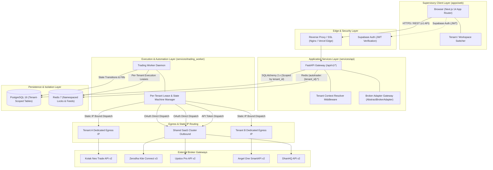

# System Architecture Specification (ARCHITECTURE.md)
## NIFTY Auto Trader 3.0 — Multi-Tenant, Multi-Broker Trading SaaS

> Technical architectural specification for **NIFTY Auto Trader 3.0** — High-reliability, multi-tenant automated trading platform for independent retail traders and desks.

---

## 1. System Topology & Architecture

The platform is designed following a **multi-tenant, distributed authoritative backend** architecture. The web browser functions strictly as a secure, reactive supervisory console, while all financial calculations, risk checks, broker sessions, and trade state machines are calculated authoritatively by FastAPI backend services and the Trading Worker.



---

## 2. Component Responsibilities

### 2.1 Next.js Web Application (`apps/web`)
- **Role**: Multi-tenant presentation and supervisory dashboard.
- **Responsibilities**:
  - Authenticate users via Supabase Auth and handle organization/workspace switching.
  - Render real-time account telemetry (funds, used margin, realized/unrealized P&L).
  - Present market feeds (NIFTY 50 spot price, 5-minute candles, option chains).
  - Provide strategy parameter editors with immutable version review.
  - Display truthful system states (`READY`, `LOADING`, `STALE`, `NOT_CONNECTED`, `ERROR`, `UNSUPPORTED`).
  - **Non-Responsibilities**:
    - Never calculates position P&L or Greeks locally.
    - Never evaluates strategy trigger conditions.
    - Never submits orders directly to broker endpoints.

### 2.2 FastAPI API Gateway (`services/api`)
- **Role**: Stateless, asynchronous HTTP/REST gateway with tenant-scoped routing.
- **Responsibilities**:
  - Validate incoming JWT bearer tokens against Supabase public keys and resolve the authenticated user's active tenant context.
  - Enforce tenant isolation on every database query (`WHERE tenant_id = :current_tenant_id`).
  - Route broker requests through the unified `AbstractBrokerAdapter` interface.
  - Validate all request payloads using Pydantic v2 schemas mirroring `@autotrader/api-contracts`.
  - Provide administrative endpoints for tenant provisioning, subscriptions, and audit logs.

### 2.3 Trading Worker Daemon (`services/trading_worker`)
- **Role**: Authoritative, stateful autonomous execution engine.
- **Responsibilities**:
  - Acquire per-tenant execution leases in Redis (`autotrader:{tenant_id}:worker:lease`).
  - Maintain an independent state machine for each active tenant account.
  - Execute scheduled strategy evaluations (e.g., 12:20 PM IST directional options entry) per tenant.
  - Perform automated pre-flight checks (funds, margins, market open, risk limits, tick/lot alignment).
  - Ensure order idempotency with unique client order references (`{tenant_id}:{order_id}`).
  - Maintain periodic worker heartbeats and trigger safety recovery mode on anomalies.

### 2.4 Persistence Layer (PostgreSQL 16 & Redis 7)
- **Role**: Single source of immutable truth for relational and financial data.
- **PostgreSQL**:
  - Stores all relational models with non-nullable `tenant_id` foreign keys.
  - Enforces exact monetary precision using `NUMERIC(15, 4)` and integer lot quantities.
  - Retains immutable audit trails and version snapshots.
- **Redis 7**:
  - Namespaced caching for market quotes and option chains (`autotrader:{tenant_id}:*`).
  - Distributed mutual exclusion locks for order placement and worker leader leases.

---

## 3. Multi-Broker Unified Abstraction Pattern

The backend communicates with external brokers via the canonical `AbstractBrokerAdapter`:

```python
class AbstractBrokerAdapter(ABC):
    @abstractmethod
    async def connect(self, credentials: Dict[str, Any]) -> BrokerConnectionStatus: ...

    @abstractmethod
    async def disconnect(self) -> None: ...

    @abstractmethod
    async def get_connection_status(self) -> BrokerConnectionStatus: ...

    @abstractmethod
    async def get_funds(self) -> AccountFunds: ...

    @abstractmethod
    async def get_positions(self) -> List[Position]: ...

    @abstractmethod
    async def get_orders(self) -> List[Order]: ...

    @abstractmethod
    async def place_order(self, request: OrderPlacementRequest) -> OrderPlacementResponse: ...

    @abstractmethod
    async def modify_order(self, request: OrderModificationRequest) -> OrderPlacementResponse: ...

    @abstractmethod
    async def cancel_order(self, order_id: str) -> bool: ...

    @abstractmethod
    async def get_nifty_quote(self) -> NiftyQuote: ...

    @abstractmethod
    async def get_option_chain(self, underlying: str, expiry: Optional[str]) -> OptionChainData: ...
```

---

## 4. Operational Safety Invariants

1. **Phase 1 Live Order Lock**: Live order submission remains disabled until compliance and release gates are approved.
2. **Double-Spend & Duplicate-BUY Prevention**: Every prospective order requires an idempotency token (`tenant_id:client_order_id`). A second order cannot be dispatched for a trade cycle while an active entry or position exists.
3. **Automated Stop-Loss Enforcement**: Every opened options position must have a broker-side protective stop-loss limit order (`SL-L`) placed or monitored continuously.
4. **Independent Watchdog Monitoring**: An external watchdog process checks worker heartbeats every 5 seconds. If a heartbeat expires (>15 seconds), the tenant engine transitions to `EngineState.ERROR` and prevents new order placements.
