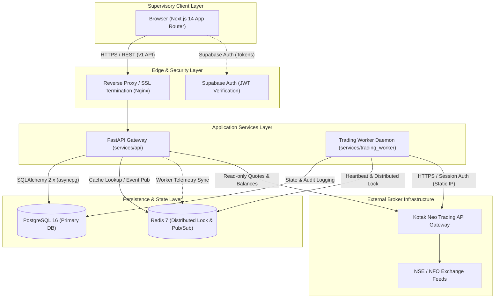
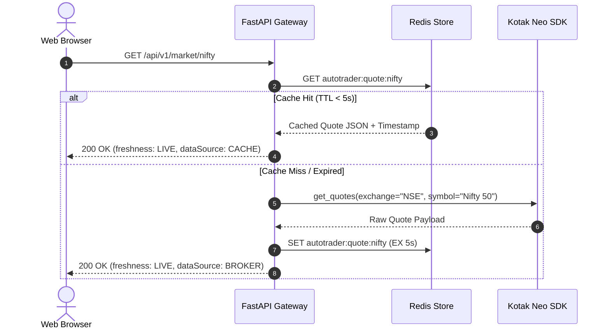
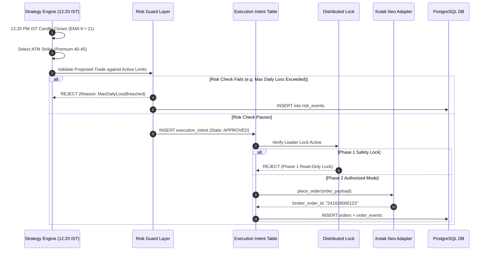
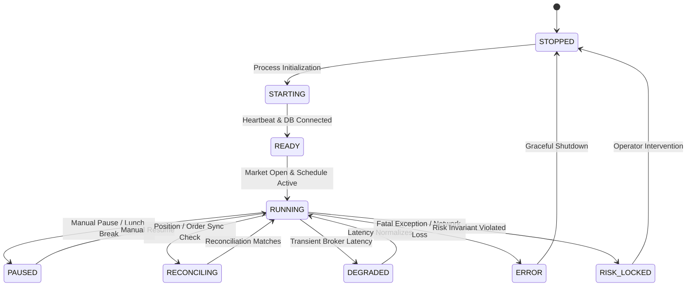

# System Architecture Specification (ARCHITECTURE.md)

> Technical architectural specification for **NIFTY Auto Trader 3.0** — High-reliability, low-latency automated trading platform.

---

## 1. Architectural Overview & System Topology

The platform is designed following a **distributed, authoritative backend** architecture. The trading worker runs as an autonomous, single-leader state machine on a dedicated Virtual Private Server (VPS) with a compliant static IP address registered with the broker. The web browser functions strictly as a secure, reactive supervisory console.



---

## 2. Component Responsibilities

### 2.1 Next.js Web Application (`apps/web`)
- **Role**: Passive supervisory dashboard and user interface.
- **Responsibilities**:
  - Authenticate administrative users using Supabase Auth JWTs.
  - Render real-time account telemetry (available cash, used margin, unrealized/realized P&L).
  - Present market data feeds (NIFTY spot price, 5-minute candles, option chains).
  - Provide strategy parameter configuration interfaces and immutable version history review.
  - Render truthful freshness badges (`LIVE`, `RECENT`, `STALE`, `UNAVAILABLE`) based on backend response metadata.
  - **Non-Responsibilities**:
    - Never calculates position P&L or Greeks locally.
    - Never evaluates strategy trigger conditions.
    - Never submits orders directly to broker endpoints.

### 2.2 FastAPI API Gateway (`services/api`)
- **Role**: Stateless, asynchronous HTTP/REST gateway for clients and administrative tools.
- **Responsibilities**:
  - Validate incoming JWT bearer tokens against Supabase public keys.
  - Expose versioned v1 REST API endpoints (`/api/v1/*`) compliant with `@autotrader/api-contracts`.
  - Validate incoming request payloads using Pydantic v2 schemas.
  - Query PostgreSQL for trade history, position snapshots, strategy versions, and system events.
  - Coordinate read-only broker session queries for funds and live option chains with short-lived Redis caching.
  - Enforce rate limiting (e.g., 60 requests/minute/user) and CORS security headers.

### 2.3 Trading Worker Daemon (`services/trading_worker`)
- **Role**: Authoritative, stateful autonomous execution engine.
- **Responsibilities**:
  - Periodically acquire and refresh the distributed leader lock in Redis (`autotrader:worker:leader`).
  - Maintain the primary engine state machine (`STOPPED` -> `STARTING` -> `READY` -> `RUNNING` -> `PAUSED` -> `RECONCILING` -> `DEGRADED` -> `ERROR` -> `RISK_LOCKED`).
  - Periodically emit worker heartbeats into PostgreSQL and Redis every 5 seconds.
  - Manage scheduled strategy lifecycle routines (e.g., pre-market setup at 09:15 AM IST, signal evaluation at 12:20 PM IST, and market close reconciliation at 15:30 PM IST).
  - Enforce strict risk invariant limits before approving execution intents.
  - **Phase 1 Safety Constraint**: Hard-locked against submitting live orders to the broker.

### 2.4 PostgreSQL 16 Persistence Engine
- **Role**: Single source of immutable truth for relational and financial data.
- **Responsibilities**:
  - Store normalized, audit-compliant financial tables (21 total tables).
  - Enforce referential integrity, foreign key cascades, and unique constraints.
  - Maintain exact precision for monetary amounts using `NUMERIC(15, 4)` and quantities using integer multiples.
  - Store timestamped historical snapshots of account funds and open positions.
  - Maintain immutable strategy version snapshots linked directly to trade cycles.

### 2.5 Redis 7 In-Memory Store
- **Role**: Coordination, distributed locking, and short-term caching.
- **Responsibilities**:
  - Single-leader distributed lock management using TTL keys (`SET NX EX 15`).
  - High-frequency quote and option-chain caching (5-second TTL) to minimize redundant broker API round-trips.
  - Fast worker liveness heartbeat checks.
  - Pub/Sub channel for system events and alerts.

### 2.6 Kotak Neo Broker Integration
- **Role**: External regulatory gateway to NSE/NFO order matching and market data systems.
- **Responsibilities**:
  - User session creation using API Consumer Key, Secret, Mobile, Password, and TOTP.
  - Real-time and historical market data quotes for NIFTY 50 and derivative strikes.
  - Broker-side account balance and order book reporting.

---

## 3. Data Flow Architecture

### 3.1 Market Data Ingestion Flow



### 3.2 Strategy Execution & Order Lifecycle Flow (Phase 2 Preview)

The architectural separation between strategy logic, risk governance, and physical order placement ensures that no rogue trade can bypass risk parameters:



---

## 4. Separation of Concerns & State Machine Governance

### 4.1 State Machine Architecture
The Trading Worker implements a strictly defined, deterministic finite state machine (FSM):



### 4.2 State Invariants
- **`STOPPED`**: All background loops terminated, no network calls to broker.
- **`STARTING`**: Initializing database connection pools, inspecting broker authentication state, acquiring leader lock.
- **`READY`**: Worker is healthy, leader lock held, awaiting scheduled market hours.
- **`RUNNING`**: Active monitoring of market candles, strategy indicators, and open positions.
- **`PAUSED`**: Strategy evaluation suspended by user command. Position tracking continues.
- **`RECONCILING`**: Reconciling local trade records with broker order books. No new orders permitted.
- **`DEGRADED`**: Broker API latency exceeds thresholds or quote feeds are intermittent.
- **`ERROR`**: Unrecoverable runtime error. Worker suspends operations and notifies operators.
- **`RISK_LOCKED`**: Hard stop triggered by risk rule breach (e.g. daily loss cap reached). Requires manual administrative unlocking.

---

## 5. High Availability, Distributed Locks & Failover

### 5.1 Single-Worker Guarantee (Anti-Split-Brain)
Trading options requires strict single-threaded state management per account. Multiple workers attempting to submit orders simultaneously would cause catastrophic double-execution.

To prevent this:
1. **Redis Leader Lock**: The worker must continuously maintain a distributed mutex with a 15-second TTL:
   ```
   SET autotrader:worker:leader <worker_id> NX EX 15
   ```
2. **Heartbeat Cadence**: Every 5 seconds, the worker:
   - Extends the Redis TTL back to 15 seconds.
   - Writes a timestamped record to the `worker_heartbeats` table in PostgreSQL.
3. **Failover Execution**: If the active leader fails or suffers a network partition for > 15 seconds:
   - The Redis key expires automatically.
   - A hot-standby worker detects the expired lock and acquires leadership.
   - The incoming leader triggers an immediate `RECONCILING` cycle to sync local state with the broker before resuming operations.

### 5.2 Standalone Fallback
In local development or test environments where Redis is disabled, the worker automatically detects the missing Redis configuration and runs in standalone leadership mode while continuing to record heartbeats to the primary database.
