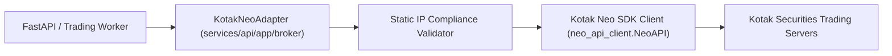
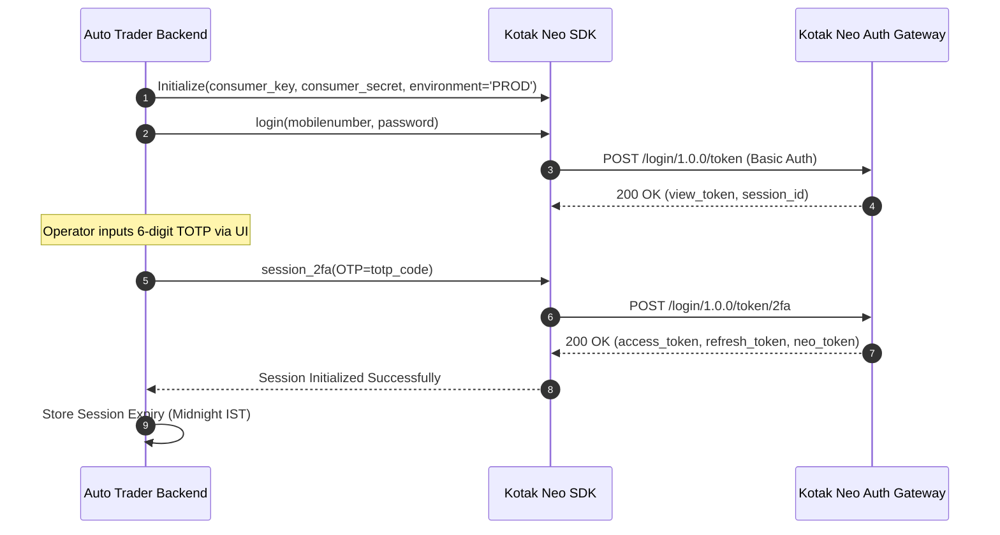

# Kotak Neo Broker Integration Specification (BROKER_INTEGRATION.md)

> Technical implementation guide for the **Kotak Neo API SDK (Python)** integration, authentication lifecycle, static-IP validation, and Phase 1 safety locking in **NIFTY Auto Trader 3.0**.

---

## 1. Overview & Official SDK Setup

Kotak Neo provides direct access to the National Stock Exchange (NSE) and NSE Futures & Options (NFO) market segments via modern REST and WebSocket APIs.

The platform integrates using the official `kotak-neo-api` library:

```bash
pip install neo-api-client
```

### SDK Client Initialization Architecture
The adapter encapsulates the SDK behind an asynchronous wrapper pattern (`KotakNeoAdapter`) that enforces request timeouts, circuit-breaking, rate-limiting, and error translation into standard `@autotrader/api-contracts` exceptions.



---

## 2. Authentication Workflow (2-Factor Authentication)

Kotak Neo utilizes an OAuth2-style authentication scheme combined with a multi-step login workflow involving user credentials and Time-based One-Time Passwords (TOTP).



### 2.1 Security Hygiene on Credentials
- **Consumer Key & Secret**: Stored exclusively as environment variables or encrypted fields in `broker_accounts`.
- **Mobile Number & Password**: Server-side environment variables only; never exposed across REST APIs or UI client bundles.
- **TOTP Code**: Entered interactively by the operator at trading session startup. **Never persisted to disk or database.**
- **Session Tokens**: Held in memory by the running process; never serialized into logs.

---

## 3. Static IP Compliance & Network Validation

Indian regulatory guidelines mandate that automated trading through broker open APIs must originate from registered, audited static IP addresses.

### 3.1 Validation Invariant
Before any API call is dispatched to Kotak Neo, the adapter validates the outbound public IP of the hosting server:
```python
async def verify_static_ip_compliance(expected_static_ip: str) -> bool:
    """Verifies that outbound traffic matches the static IP registered with Kotak Securities."""
    async with httpx.AsyncClient(timeout=5.0) as client:
        resp = await client.get("https://api.ipify.org?format=json")
        current_ip = resp.json().get("ip")
        
    if current_ip != expected_static_ip:
        logger.critical(
            f"Static IP Mismatch! Expected {expected_static_ip}, but outbound IP is {current_ip}. "
            "Broker access is blocked to prevent compliance violations."
        )
        return False
    return True
```
If the IP does not match the registered static IP, all broker interactions are blocked immediately.

---

## 4. Read-Only Method Specifications (Phase 1)

In Phase 1, only the following **read-only telemetry methods** are exposed and utilized:

### 4.1 Account & Funds Telemetry
- **`get_funds()`**:
  - Broker Call: `client.limits()`
  - Maps to: `AccountFundsResponse` (`availableCash`, `usedMargin`, `availableMargin`, `unrealizedPnl`).
  - Cache TTL: 10 seconds.
- **`get_positions()`**:
  - Broker Call: `client.positions()`
  - Maps to: `Position[]` (Symbol, Exchange, Net Quantity, Buy Avg, MTM P&L).
  - Normalizes product codes (`MIS`, `NRML`) and computes percentage returns.
- **`get_orders()`**:
  - Broker Call: `client.order_report()`
  - Maps to: `Order[]` (Order ID, Status, Traded Qty, Price, Timestamp).
- **`get_tradebook()`**:
  - Broker Call: `client.trade_report()`
  - Maps to: `Trade[]` (Execution ID, Fill Price, Executed Qty).

### 4.2 Market Data & Quotes
- **`get_quotes(exchange: str, symbol: str)`**:
  - Broker Call: `client.quotes(exchange_segment=exchange, symbol=symbol)`
  - Returns: Last Price, Open, High, Low, Close, Day Volume, 5-level market depth.
- **`get_historical_candles(instrument_token: str, interval: str, count: int)`**:
  - Broker Call: `client.historical_candle_data(...)`
  - Returns: OHLCV array formatted to `CandlesResponse`.
- **`get_option_chain(underlying: str, expiry_date: str)`**:
  - Reads instruments master for current weekly expiry strikes.
  - Concurrently queries quotes for CE and PE strike ladder.
  - Normalizes into `OptionChainResponse`.

---

## 5. Phase 1 Order Execution Hard Lock

> [!CAUTION]
> Order submission and modification methods are permanently locked in Phase 1 to prevent accidental financial liability.

The SDK adapter wraps all write calls with an unconditional safety assertion:

```python
class KotakNeoAdapter:
    def place_order(self, *args, **kwargs):
        raise PhaseSafetyViolation(
            "PHASE_1_ORDER_LOCK: Order placement is strictly disabled in Phase 1. "
            "No orders may be submitted to Kotak Neo."
        )

    def modify_order(self, *args, **kwargs):
        raise PhaseSafetyViolation("PHASE_1_ORDER_LOCK: Order modification is strictly disabled in Phase 1.")

    def cancel_order(self, *args, **kwargs):
        raise PhaseSafetyViolation("PHASE_1_ORDER_LOCK: Order cancellation is strictly disabled in Phase 1.")
```

---

## 6. Session Lifecycle & Reconnection Strategy

Kotak Neo sessions remain valid until market close (around 16:00 PM IST) unless invalidated:
1. **Periodic Health Probe**: Every 60 seconds during market hours, the adapter executes a lightweight quote query (`Nifty 50`) to verify session liveness.
2. **Session Expiry Detection**: An HTTP 401 response or error token `'Session Expired'` from Kotak triggers `BrokerConnectionState.SESSION_EXPIRED`.
3. **Automated Notification**: Emits a `CRITICAL` system event to the web console alerting the operator to provide a fresh TOTP code.
4. **Zero-Mock Policy**: If disconnected, unconfigured, or expired, the backend serves truthful `DataFreshness.UNAVAILABLE` payloads. It never synthesizes mock balances or fabricated trades.
