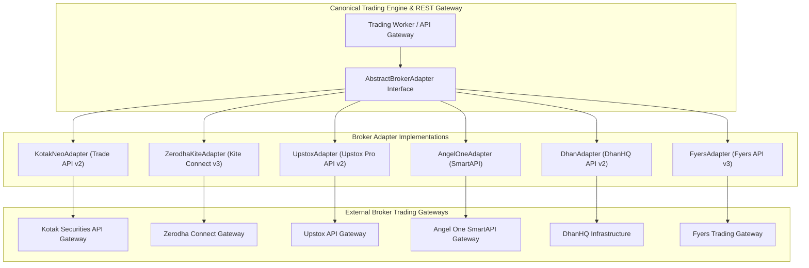
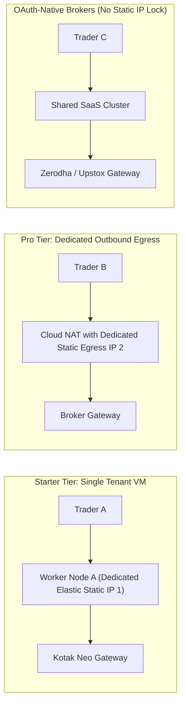
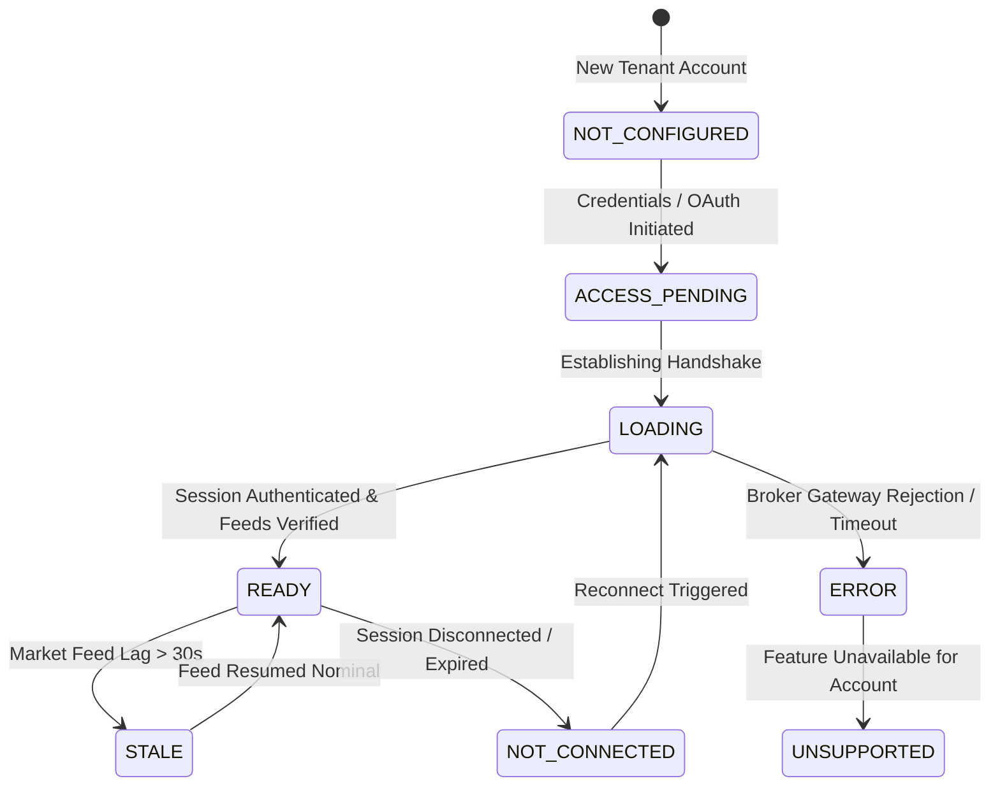

# Multi-Broker Capability & Compliance Matrix (BROKER_MATRIX.md)

> Canonical comparison of supported broker APIs, authentication mechanisms, network boundaries, and compliance constraints for **NIFTY Auto Trader 3.0**.

---

## 1. Broker Integration Strategy

To provide independent traders with flexibility while preserving architectural unity, NIFTY Auto Trader 3.0 implements a **canonical broker adapter interface** (`AbstractBrokerAdapter`). All broker-specific nuances (payload structures, authentication sequences, WebSocket protocols, error codes) are encapsulated within dedicated adapters behind uniform data contracts.

---

## 2. Canonical Broker Comparison Matrix

| Specification | Kotak Neo | Zerodha Kite | Upstox Pro | Angel One | DhanHQ | Fyers |
| :--- | :--- | :--- | :--- | :--- | :--- | :--- |
| **API Version** | Trade API v2 | Kite Connect v3 | Upstox API v2 | SmartAPI v2 | DhanHQ v2 | Fyers API v3 |
| **Primary Auth Flow** | TOTP + MPIN / Password | OAuth 2.0 (Login URL) | OAuth 2.0 (PKCE) | TOTP + Password / MPIN | Access Token + Secret | OAuth 2.0 Flow |
| **Broker-Hosted Login?** | Limited / API-driven | **Yes** (Kite Login) | **Yes** (Upstox Login) | Limited / API-driven | **Yes** (Dhan Web) | **Yes** (Fyers Login) |
| **Daily Session Expiry** | 24 Hours / EOD | 06:00 AM IST daily | 24 Hours / EOD | 24 Hours / EOD | 30 Days (Token) | 24 Hours / EOD |
| **Static IP Mandatory?** | **Yes** (Whitelist portal) | No (App-bound) | No (App-bound) | **Yes** (IP Binding) | **Yes** (API Whitelist) | Optional |
| **Order Placement Rate Limit** | 10 req / sec | 10 req / sec | 25 req / sec | 10 req / sec | 10 req / sec | 10 req / sec |
| **Quote Rate Limit** | 1 req / sec (REST) | 3 req / sec | 10 req / sec | 3 req / sec | 5 req / sec | 5 req / sec |
| **WebSocket Market Feed** | Binary / JSON Ticks | Binary Packets | Protobuf WebSocket | Binary / Text Ticks | Binary Packets | Binary Protobuf |
| **NIFTY Options Depth** | Level 1 / Best 5 | Level 1 / Best 5 | Level 1 / Best 5 | Level 1 / Best 5 | Level 1 / Best 5 | Level 1 / Best 5 |
| **SL-L Order Support** | Yes (`SL`) | Yes (`SL`) | Yes (`SL`) | Yes (`STOPLOSS_LIMIT`) | Yes (`SL`) | Yes (`SL-L`) |
| **Market Orders for Options** | Disallowed by broker | Disallowed (Limit only)| Disallowed (Limit only) | Disallowed (Limit only) | Disallowed | Disallowed |
| **Execution Quality / Fills** | Tradebook API | Orderbook + Postbacks | WebSocket Postbacks | Orderbook API | Webhooks / Postbacks | Webhooks |

---

## 3. Credential & 2FA Handling Invariants

> [!IMPORTANT]
> In accordance with **Rule 18** and Indian cybersecurity guidelines:
> - The SaaS platform **does not collect or store client broker passwords, MPINs, or TOTP seeds** in plain text.
> - For brokers offering standard OAuth 2.0 (Zerodha, Upstox, Dhan, Fyers), the trader authorizes via the broker's official hosted portal. The platform stores only the resulting ephemeral access token and refresh token.
> - For brokers requiring API-driven credentials (Kotak Neo, Angel One), credentials must be stored encrypted using **AES-256-GCM envelope encryption** with distinct data encryption keys per tenant.
> - Daily session renewal occurs either via interactive broker-hosted re-login or via tenant-consented automated session workers where formally compliant.

---

## 4. Static-IP Compliance & Network Routing Architecture

> [!CAUTION]
> **Rule 20 Invariant**: Unrelated traders' live order flow must never be routed through a single shared static IP without broker and exchange authorization.

### 4.1 Deployment Topologies by Subscription Tier

1. **Static IP-Bound Brokers (Kotak Neo, Angel One, Dhan)**:
   - For tenants utilizing static-IP-bound brokers in LIVE trading mode, orders must egress via a verified, whitelisted static IP address dedicated to that tenant's execution context.
   - The platform verifies outbound IP address parity via `/api/v1/broker/ip-check` before submitting orders.
2. **Dynamic / OAuth-Native Brokers (Zerodha Kite, Upstox)**:
   - Zerodha Kite Connect and Upstox Pro API bind authorization to registered API keys and redirect URLs rather than rigid client IP whitelists.
   - These brokers can be routed through scalable SaaS application clusters while adhering to application-level rate limits.

---

## 5. Standardized Genuine Connection States

Per **Rule 24**, the platform UI and API must report genuine broker states without masking or synthesizing connectivity:

- **`NOT_CONFIGURED`**: No broker credentials or OAuth integrations exist for this tenant.
- **`ACCESS_PENDING`**: OAuth redirect pending user authorization on broker website.
- **`LOADING`**: Handshake, JWT exchange, or feed subscription in progress.
- **`READY`**: Authenticated session active, market feeds streaming, static IP verified.
- **`STALE`**: Broker connection established but market data ticks older than 30 seconds.
- **`NOT_CONNECTED`**: Daily session expired or broker connection closed cleanly.
- **`ERROR`**: Authentication rejection, network partition, or API gateway error.
- **`UNSUPPORTED`**: Tenant attempted an order type or feature not supported by this broker.
