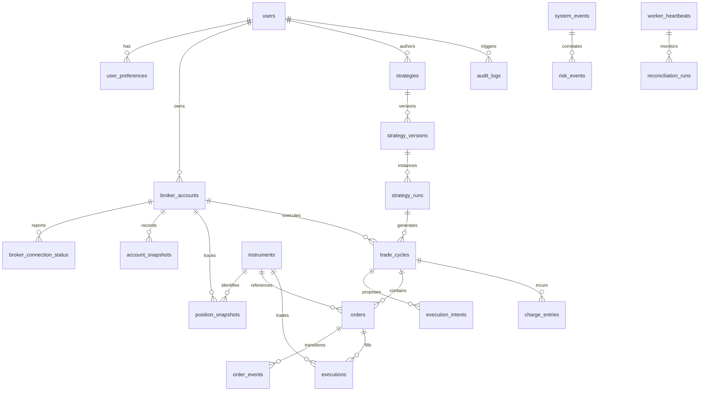

# Database Architecture & Relational Schema (DATABASE.md)

> Comprehensive relational database specification for **NIFTY Auto Trader 3.0**, powered by PostgreSQL 16, SQLAlchemy 2.x async ORM, and Alembic migrations.

---

## 1. Schema Overview & Entity-Relationship Architecture

The schema contains **21 normalized tables** designed for high financial precision, complete auditability, and zero data loss. Every trade cycle, order state transition, risk evaluation, and user configuration is permanently recorded.

---

## 2. Table Specifications (All 21 Tables)

### 2.1 Identity & Configuration Tables

#### `users`
Represents the system operators and account holders authenticated via Supabase Auth.
- `id` (UUID, Primary Key): Mirrors Supabase user ID.
- `email` (VARCHAR(255), Unique, Not Null): User login email.
- `full_name` (VARCHAR(255), Nullable): Full display name.
- `role` (VARCHAR(50), Not Null, Default: `'OPERATOR'`): Role-based access control (`ADMIN`, `OPERATOR`, `AUDITOR`).
- `is_active` (BOOLEAN, Not Null, Default: `true`): Account state.
- `created_at` (TIMESTAMPTZ, Not Null, Default: `NOW()`): UTC creation timestamp.
- `updated_at` (TIMESTAMPTZ, Not Null, Default: `NOW()`): UTC update timestamp.

#### `user_preferences`
Key-value preferences and notification settings per user.
- `id` (UUID, Primary Key)
- `user_id` (UUID, FK -> `users.id`, ON DELETE CASCADE, Unique)
- `theme` (VARCHAR(20), Default: `'dark'`)
- `sound_alerts_enabled` (BOOLEAN, Default: `true`)
- `push_notifications_enabled` (BOOLEAN, Default: `false`)
- `default_dashboard_layout` (JSONB, Default: `'{}'`)
- `updated_at` (TIMESTAMPTZ, Not Null, Default: `NOW()`)

#### `broker_accounts`
Credentials metadata and configuration for broker accounts (e.g., Kotak Neo). Sensitive secrets are encrypted.
- `id` (UUID, Primary Key)
- `user_id` (UUID, FK -> `users.id`, ON DELETE CASCADE)
- `broker_name` (VARCHAR(50), Not Null, Default: `'KOTAK_NEO'`)
- `account_id` (VARCHAR(100), Not Null): Broker client/login code.
- `consumer_key` (VARCHAR(255), Not Null): Kotak Neo API Consumer Key.
- `registered_mobile` (VARCHAR(20), Not Null): Registered mobile number.
- `static_ip` (VARCHAR(45), Nullable): Configured static IP address whitelisted at broker.
- `is_active` (BOOLEAN, Not Null, Default: `true`)
- `created_at` (TIMESTAMPTZ, Not Null, Default: `NOW()`)
- `updated_at` (TIMESTAMPTZ, Not Null, Default: `NOW()`)

#### `broker_connection_status`
Real-time connection state, token expiration, and diagnostic health for each broker account.
- `id` (UUID, Primary Key)
- `broker_account_id` (UUID, FK -> `broker_accounts.id`, ON DELETE CASCADE, Unique)
- `state` (VARCHAR(30), Not Null, Default: `'NOT_CONFIGURED'`): Enum (`NOT_CONFIGURED`, `DISCONNECTED`, `CONNECTING`, `CONNECTED`, `SESSION_EXPIRED`, `ERROR`).
- `connected_at` (TIMESTAMPTZ, Nullable)
- `session_expires_at` (TIMESTAMPTZ, Nullable)
- `market_feed_status` (VARCHAR(20), Default: `'DISCONNECTED'`)
- `order_feed_status` (VARCHAR(20), Default: `'DISCONNECTED'`)
- `report_api_status` (VARCHAR(20), Default: `'DISCONNECTED'`)
- `static_ip_compliant` (BOOLEAN, Nullable)
- `last_error` (TEXT, Nullable)
- `last_checked_at` (TIMESTAMPTZ, Not Null, Default: `NOW()`)

---

### 2.2 Market & Financial Instrument Tables

#### `instruments`
Master security directory for cash equities, indices, futures, and option contracts.
- `id` (UUID, Primary Key)
- `instrument_token` (VARCHAR(100), Not Null, Unique): Broker's internal token identifier.
- `trading_symbol` (VARCHAR(100), Not Null, Index): Market exchange trading symbol (e.g., `NIFTY24OCT2424500CE`).
- `exchange` (VARCHAR(20), Not Null): `NSE`, `NFO`, `BSE`, `BFO`, `CDS`, `MCX`.
- `instrument_type` (VARCHAR(20), Not Null): `INDEX`, `EQUITY`, `FUTURES`, `OPTIONS`.
- `underlying_symbol` (VARCHAR(50), Nullable, Index): Underlying asset (e.g., `NIFTY`).
- `strike_price` (NUMERIC(15, 4), Nullable): Strike price for option contracts.
- `option_type` (VARCHAR(5), Nullable): `CE` or `PE`.
- `expiry_date` (DATE, Nullable, Index): Option contract expiry date.
- `lot_size` (INTEGER, Not Null, Default: 1): Exchange-mandated contract lot size (e.g., 25 for NIFTY).
- `tick_size` (NUMERIC(15, 4), Not Null, Default: 0.05): Minimum price movement.
- `is_active` (BOOLEAN, Not Null, Default: `true`)
- `updated_at` (TIMESTAMPTZ, Not Null, Default: `NOW()`)

#### `account_snapshots`
Time-series ledger recording account balance and margin utilization snapshots.
- `id` (UUID, Primary Key)
- `broker_account_id` (UUID, FK -> `broker_accounts.id`, ON DELETE CASCADE, Index)
- `available_cash` (NUMERIC(15, 4), Not Null)
- `used_margin` (NUMERIC(15, 4), Not Null)
- `available_margin` (NUMERIC(15, 4), Not Null)
- `total_collateral` (NUMERIC(15, 4), Not Null, Default: 0)
- `unrealized_pnl` (NUMERIC(15, 4), Not Null, Default: 0)
- `realized_pnl_today` (NUMERIC(15, 4), Not Null, Default: 0)
- `captured_at` (TIMESTAMPTZ, Not Null, Default: `NOW()`, Index)

#### `position_snapshots`
Historical snapshots of open and closed intraday positions.
- `id` (UUID, Primary Key)
- `broker_account_id` (UUID, FK -> `broker_accounts.id`, ON DELETE CASCADE, Index)
- `instrument_id` (UUID, FK -> `instruments.id`, Index)
- `trading_symbol` (VARCHAR(100), Not Null)
- `exchange` (VARCHAR(20), Not Null)
- `product` (VARCHAR(20), Not Null, Default: `'MIS'`): Product code (`MIS`, `NRML`, `CNC`).
- `side` (VARCHAR(10), Not Null): `BUY` or `SELL`.
- `quantity` (INTEGER, Not Null): Current net position quantity.
- `average_price` (NUMERIC(15, 4), Not Null): Weighted average purchase/sale price.
- `last_price` (NUMERIC(15, 4), Not Null): Last traded market price.
- `pnl` (NUMERIC(15, 4), Not Null): Total mark-to-market P&L.
- `pnl_percentage` (NUMERIC(8, 4), Not Null): Percentage return on capital.
- `day_pnl` (NUMERIC(15, 4), Not Null): Today's mark-to-market change.
- `snapshot_time` (TIMESTAMPTZ, Not Null, Default: `NOW()`, Index)

---

### 2.3 Trading Execution & Order Lifecycle Tables

#### `trade_cycles`
Encapsulates an entire round-trip trade lifecycle from planned entry to terminal exit.
- `id` (UUID, Primary Key)
- `broker_account_id` (UUID, FK -> `broker_accounts.id`, Index)
- `strategy_run_id` (UUID, FK -> `strategy_runs.id`, Index)
- `strategy_version_id` (UUID, FK -> `strategy_versions.id`): Immutable strategy version snapshot.
- `cycle_number` (INTEGER, Not Null): Intraday cycle sequence index.
- `state` (VARCHAR(30), Not Null, Default: `'PENDING_ENTRY'`): `PENDING_ENTRY`, `ENTRY_PLACED`, `IN_POSITION`, `EXIT_PLACED`, `CLOSED`, `CANCELLED`, `ERROR`.
- `trading_symbol` (VARCHAR(100), Not Null)
- `direction` (VARCHAR(10), Not Null): `BUY` (Long Call or Long Put).
- `target_entry_price` (NUMERIC(15, 4), Nullable)
- `actual_entry_price` (NUMERIC(15, 4), Nullable)
- `stop_loss_price` (NUMERIC(15, 4), Nullable)
- `target_exit_price` (NUMERIC(15, 4), Nullable)
- `actual_exit_price` (NUMERIC(15, 4), Nullable)
- `gross_pnl` (NUMERIC(15, 4), Nullable)
- `net_pnl` (NUMERIC(15, 4), Nullable)
- `entry_at` (TIMESTAMPTZ, Nullable)
- `exit_at` (TIMESTAMPTZ, Nullable)
- `exit_reason` (VARCHAR(100), Nullable): E.g., `'TARGET_REACHED'`, `'STOP_LOSS_HIT'`, `'TIME_BASED_EXIT'`, `'RISK_INTERVENTION'`.
- `created_at` (TIMESTAMPTZ, Not Null, Default: `NOW()`)
- `updated_at` (TIMESTAMPTZ, Not Null, Default: `NOW()`)

#### `execution_intents`
Deterministic record of trade ideas generated by strategies before sending to broker.
- `id` (UUID, Primary Key)
- `trade_cycle_id` (UUID, FK -> `trade_cycles.id`, Index)
- `intent_type` (VARCHAR(20), Not Null): `ENTRY`, `EXIT`, `STOP_LOSS`, `TRAIL`.
- `proposed_symbol` (VARCHAR(100), Not Null)
- `proposed_quantity` (INTEGER, Not Null)
- `proposed_price` (NUMERIC(15, 4), Nullable)
- `status` (VARCHAR(30), Not Null, Default: `'PROPOSED'`): `PROPOSED`, `VALIDATING`, `APPROVED`, `REJECTED`, `DISPATCHED`.
- `rejection_reason` (TEXT, Nullable)
- `created_at` (TIMESTAMPTZ, Not Null, Default: `NOW()`)

#### `orders`
Immutable record of all broker orders dispatched or received.
- `id` (UUID, Primary Key)
- `trade_cycle_id` (UUID, FK -> `trade_cycles.id`, Nullable, Index)
- `strategy_run_id` (UUID, FK -> `strategy_runs.id`, Nullable, Index)
- `broker_order_id` (VARCHAR(100), Nullable, Unique, Index): External broker order reference.
- `idempotency_key` (VARCHAR(100), Not Null, Unique, Index): Client-generated deterministic token.
- `trading_symbol` (VARCHAR(100), Not Null)
- `exchange` (VARCHAR(20), Not Null)
- `side` (VARCHAR(10), Not Null): `BUY` or `SELL`.
- `order_type` (VARCHAR(20), Not Null): `MARKET`, `LIMIT`, `SL`, `SL_MARKET`.
- `quantity` (INTEGER, Not Null)
- `filled_quantity` (INTEGER, Not Null, Default: 0)
- `price` (NUMERIC(15, 4), Not Null, Default: 0)
- `trigger_price` (NUMERIC(15, 4), Nullable)
- `average_filled_price` (NUMERIC(15, 4), Nullable)
- `status` (VARCHAR(30), Not Null, Default: `'PENDING'`): `PENDING`, `OPEN`, `PARTIALLY_FILLED`, `FILLED`, `CANCELLED`, `REJECTED`, `EXPIRED`, `ERROR`.
- `status_message` (TEXT, Nullable)
- `placed_at` (TIMESTAMPTZ, Not Null, Default: `NOW()`)
- `updated_at` (TIMESTAMPTZ, Not Null, Default: `NOW()`)

#### `order_events`
Audit log of individual state transitions for every order.
- `id` (UUID, Primary Key)
- `order_id` (UUID, FK -> `orders.id`, ON DELETE CASCADE, Index)
- `previous_status` (VARCHAR(30), Nullable)
- `new_status` (VARCHAR(30), Not Null)
- `broker_status_raw` (VARCHAR(100), Nullable)
- `message` (TEXT, Nullable)
- `event_time` (TIMESTAMPTZ, Not Null, Default: `NOW()`, Index)

#### `executions`
Actual execution fills returned by exchange trade reports.
- `id` (UUID, Primary Key)
- `order_id` (UUID, FK -> `orders.id`, Index)
- `broker_trade_id` (VARCHAR(100), Not Null, Unique, Index): Exchange trade identifier.
- `trading_symbol` (VARCHAR(100), Not Null)
- `exchange` (VARCHAR(20), Not Null)
- `side` (VARCHAR(10), Not Null)
- `quantity` (INTEGER, Not Null)
- `price` (NUMERIC(15, 4), Not Null)
- `trade_time` (TIMESTAMPTZ, Not Null, Index)
- `created_at` (TIMESTAMPTZ, Not Null, Default: `NOW()`)

#### `charge_entries`
Itemized regulatory, exchange, and brokerage fees per trade cycle.
- `id` (UUID, Primary Key)
- `trade_cycle_id` (UUID, FK -> `trade_cycles.id`, ON DELETE CASCADE, Index)
- `charge_type` (VARCHAR(50), Not Null): `BROKERAGE`, `STT`, `EXCHANGE_TURNOVER`, `SEBI_TURNOVER`, `GST`, `STAMP_DUTY`.
- `amount` (NUMERIC(15, 4), Not Null)
- `created_at` (TIMESTAMPTZ, Not Null, Default: `NOW()`)

---

### 2.4 Strategy & Governance Tables

#### `strategies`
Top-level strategy metadata and operational switch.
- `id` (UUID, Primary Key)
- `user_id` (UUID, FK -> `users.id`)
- `name` (VARCHAR(100), Not Null, Unique)
- `description` (TEXT, Nullable)
- `trading_mode` (VARCHAR(20), Not Null, Default: `'OFF'`): `OFF`, `PAPER`, `LIVE`.
- `is_active` (BOOLEAN, Not Null, Default: `false`)
- `current_version` (INTEGER, Not Null, Default: 1)
- `created_at` (TIMESTAMPTZ, Not Null, Default: `NOW()`)
- `updated_at` (TIMESTAMPTZ, Not Null, Default: `NOW()`)

#### `strategy_versions`
**Immutable parameter snapshots**. Whenever a strategy configuration is updated, a new version row is appended. Trade cycles point to the specific version active during execution.
- `id` (UUID, Primary Key)
- `strategy_id` (UUID, FK -> `strategies.id`, ON DELETE CASCADE, Index)
- `version` (INTEGER, Not Null)
- `config_json` (JSONB, Not Null): Complete JSON payload of strategy parameters.
- `checksum` (VARCHAR(64), Not Null): SHA-256 hash of `config_json`.
- `is_live_ready` (BOOLEAN, Not Null, Default: `false`): Requires all risk fields populated.
- `created_by` (UUID, FK -> `users.id`)
- `created_at` (TIMESTAMPTZ, Not Null, Default: `NOW()`)
- Constraint: `UNIQUE (strategy_id, version)`

#### `strategy_runs`
Execution run instances for a strategy on a specific trading date.
- `id` (UUID, Primary Key)
- `strategy_version_id` (UUID, FK -> `strategy_versions.id`, Index)
- `trading_date` (DATE, Not Null, Index)
- `state` (VARCHAR(30), Not Null, Default: `'INITIALIZED'`): `INITIALIZED`, `SCHEDULED`, `RUNNING`, `COMPLETED`, `ABORTED`.
- `trades_count` (INTEGER, Not Null, Default: 0)
- `total_realized_pnl` (NUMERIC(15, 4), Not Null, Default: 0)
- `started_at` (TIMESTAMPTZ, Nullable)
- `completed_at` (TIMESTAMPTZ, Nullable)
- Constraint: `UNIQUE (strategy_version_id, trading_date)`

---

### 2.5 Safety, Monitoring & Diagnostics Tables

#### `risk_events`
Log of every risk parameter violation, circuit breaker trip, or anomalous rejection.
- `id` (UUID, Primary Key)
- `severity` (VARCHAR(20), Not Null): `WARNING`, `ERROR`, `CRITICAL`.
- `event_type` (VARCHAR(50), Not Null): E.g., `MAX_DAILY_LOSS_BREACH`, `SPREAD_TOO_WIDE`, `STALE_DATA_DETECTED`.
- `message` (TEXT, Not Null)
- `details` (JSONB, Nullable)
- `acknowledged` (BOOLEAN, Not Null, Default: `false`)
- `created_at` (TIMESTAMPTZ, Not Null, Default: `NOW()`, Index)

#### `system_events`
Operational diagnostic log of system activities, transitions, and external service errors.
- `id` (UUID, Primary Key)
- `severity` (VARCHAR(20), Not Null): `INFO`, `WARNING`, `ERROR`, `CRITICAL`.
- `category` (VARCHAR(50), Not Null): E.g., `WORKER`, `BROKER_API`, `DATABASE`, `SECURITY`.
- `message` (TEXT, Not Null)
- `details` (JSONB, Nullable)
- `created_at` (TIMESTAMPTZ, Not Null, Default: `NOW()`, Index)

#### `worker_heartbeats`
Distributed worker health tracker for leader monitoring and split-brain detection.
- `id` (UUID, Primary Key)
- `worker_id` (VARCHAR(100), Not Null, Index)
- `hostname` (VARCHAR(255), Not Null)
- `is_leader` (BOOLEAN, Not Null, Default: `false`)
- `engine_state` (VARCHAR(30), Not Null)
- `trading_mode` (VARCHAR(20), Not Null)
- `heartbeat_time` (TIMESTAMPTZ, Not Null, Default: `NOW()`, Index)

#### `reconciliation_runs`
Records periodic state reconciliation checks between local database records and broker accounts.
- `id` (UUID, Primary Key)
- `worker_id` (VARCHAR(100), Not Null)
- `status` (VARCHAR(20), Not Null): `MATCH`, `MISMATCH_RESOLVED`, `CRITICAL_MISMATCH`.
- `discrepancy_details` (JSONB, Nullable)
- `reconciled_at` (TIMESTAMPTZ, Not Null, Default: `NOW()`, Index)

#### `audit_logs`
Tamper-evident record of all operator actions, state changes, and config updates.
- `id` (UUID, Primary Key)
- `user_id` (UUID, FK -> `users.id`, Nullable, Index)
- `action` (VARCHAR(100), Not Null): E.g., `STRATEGY_CONFIG_UPDATED`, `TRADING_MODE_CHANGED`.
- `target_entity` (VARCHAR(100), Not Null)
- `target_id` (VARCHAR(100), Nullable)
- `ip_address` (VARCHAR(45), Nullable)
- `diff` (JSONB, Nullable): JSON diff representing previous and updated values.
- `created_at` (TIMESTAMPTZ, Not Null, Default: `NOW()`, Index)

---

## 3. Financial Precision & Integrity Rules

> [!IMPORTANT]
> Standard floating-point data types (`FLOAT`, `REAL`, `DOUBLE PRECISION`) are **strictly prohibited** for financial numbers.

1. **Exact Representation**: All currency amounts, strike prices, premiums, fees, and P&L entries must be defined as `NUMERIC(15, 4)` in PostgreSQL.
2. **Deterministic Quantities**: Quantities must be integer counts representing individual shares/units, and must be validated against `instruments.lot_size`.
3. **UTC Timestamps**: All temporal columns must use `TIMESTAMPTZ` (timestamp with time zone) and store values normalized to UTC.
4. **Idempotency Keys**: Orders must carry unique, deterministic `idempotency_key` values to eliminate any potential for duplicate order placement during network timeouts.

---

## 4. Alembic Migration Strategy

1. **Location**: All migration scripts reside in [services/api/alembic/versions](file:///d:/Coding/Auto%20Trader%203.0/services/api/alembic).
2. **Safety Rule**: Destructive operations (`drop_table`, `drop_column`) are rejected in automated pipelines.
3. **Execution Commands**:
   - Apply pending migrations: `alembic upgrade head`
   - Generate new revision: `alembic revision --autogenerate -m "descriptive_title"`
   - Check current revision: `alembic current`
   - Rollback one revision: `alembic downgrade -1`
