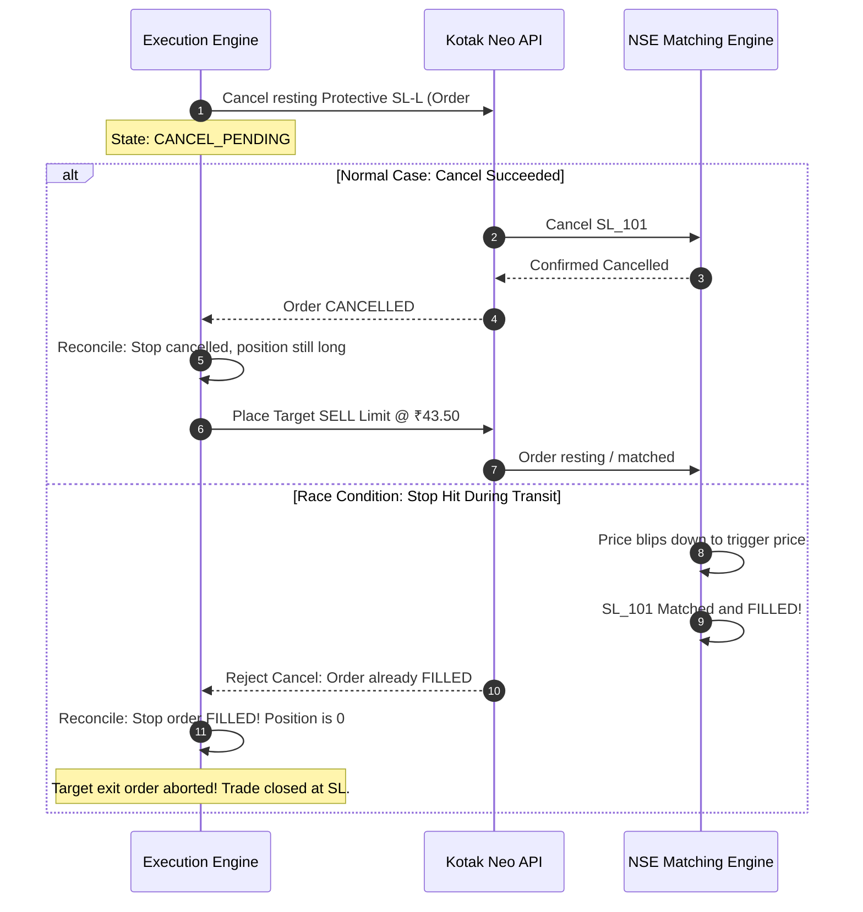

# Failure Mode Analysis & Operational Recovery Runbooks (FAILURE_MODES.md)

> Comprehensive technical analysis of the 18 critical failure scenarios, single-authority exit edge cases, unprotected latency intervals, and manual disaster recovery runbooks for **NIFTY Auto Trader 3.0**.

---

## 1. Executive Summary & Safety Philosophy

Automated intraday options trading on the Indian exchange (NSE/NFO) involves severe latency, liquidity, network, and exchange-specific failure modes. The primary philosophy of **NIFTY Auto Trader 3.0** is:

1. **Capital Preservation First**: Missing a profitable trade is acceptable; experiencing an unhedged, untracked, or duplicate order is strictly unacceptable.
2. **Deterministic State Transitions**: No blind HTTP retries on timeout. Every order status uncertainty transitions into `UNKNOWN` and triggers automated reconciliation.
3. **Single-Authority Exit Management**: Because Indian retail brokers do not support native OCO brackets for equity options, only one resting exit order exists at any moment. Target exits use strict Cancel-Confirm-Reconcile transitions.
4. **No Guaranteed Stop Fill**: Stop-Loss Limit (SL-L) orders do not guarantee execution in fast gap-down markets. The system monitors slippage actively.

---

## 2. Catalog of 18 Failure Modes

| ID | Category | Scenario Title | Trigger Condition | Automated Engine Response | Unprotected Window | Recovery Runbook |
| :--- | :--- | :--- | :--- | :--- | :---: | :--- |
| **FM-01** | `NETWORK` | Broker API HTTP Timeout on Submission | Kotak Neo API fails to respond within 10s during `place_order` | Transitions order to `UNKNOWN`. Halts retries. Initiates automated reconciliation query. | 15s | Query orderbook by client correlation ID. If confirmed placed, sync state; if absent after 30s backoff, mark `REJECTED`. |
| **FM-02** | `BROKER_API` | Session Expiration During Trading Hours | Kotak Neo returns HTTP 401 / session expired error | Transitions connection to `SESSION_EXPIRED`. Inhibits new entries. Logs CRITICAL alert. | 0s | Operator must re-authenticate via web dashboard using 2FA TOTP or MPIN. |
| **FM-03** | `EXECUTION` | Protective SL-L Order Submission Failure | BUY fills, but protective SL-L order rejected by exchange/broker | Immediately trips engine to `RISK_LOCKED`. Executes emergency market square-off of open position. | 2s | Verify position is zero. Review broker rejection reason. Resolve tick/margin/token error before restart. |
| **FM-04** | `EXECUTION` | Target Exit & Stop-Loss Cancel Race Condition | Target price hit; SL-L cancel dispatched but stop fills at exchange simultaneously | Detects stop fill during reconciliation. Forbids duplicate target sell. Marks trade cycle closed at SL. | 1s | Automatic. Local ledger reconciles to true broker tradebook without human intervention. |
| **FM-05** | `EXECUTION` | Fast Market Gap-Down Past Stop-Loss (SL-L Skip) | Option premium gaps downward below stop limit price without execution | Monitors slippage. If price is 5% below stop and order rests unfilled, triggers market square-off. | 5s | Never rely solely on exchange SL-L. Autonomous worker applies time/slippage protective exit. |
| **FM-06** | `EXECUTION` | Partial Fill on Entry Order | Requested 50 units (2 lots), only 25 units match and order expires/cancels | Recalculates position size strictly from confirmed executions (25 units). Sizes protective SL-L to 25 units. | 0s | Overselling guard prevents selling 50 units. Exit matches actual confirmed filled quantity. |
| **FM-07** | `RISK` | Daily Circuit Breaker (Max Daily Loss Breach) | Realized daily loss reaches configured maxDailyLoss (e.g., ₹3,000) | Transitions engine to `RISK_LOCKED`. Cancels all pending working orders. Blocks new entries for the day. | 0s | Requires supervisor review and manual unlock after trading session closure. |
| **FM-08** | `INFRASTRUCTURE`| VPS / Worker Process Unexpected Crash & Restart | Worker container killed by OOM or host reboot during open position | On restart, startup reconciliation queries broker tradebook and positions before any execution. | 10s | System restores in-flight TradeCycle state from database and re-links resting broker orders. |
| **FM-09** | `BROKER_API` | Static IP Whitelist Invalidation | VPS egress IP does not match Kotak Neo registered static IP | Broker rejects connection. Connection status marks staticIpCompliant=false. LIVE execution locked. | 0s | Verify VPS routing table and Kotak Neo API portal IP whitelist. |
| **FM-10** | `RISK` | Stale Market Data Quote Ingestion | NIFTY spot or option quote timestamp exceeds maxDataAgeSeconds (10s) | Strategy engine aborts evaluation. Trend marked STALE_DATA. Returns NO_TRADE. | 0s | Check broker market data websocket feeds. Trading resumes when fresh quotes arrive. |
| **FM-11** | `EXECUTION` | Attempt to Place Live Order Without Approved Risk Settings | Operator toggles LIVE mode while maxDailyLoss or maxRiskPerTrade are null/zero | Safety lock permanently raises SafetyLockViolation. Rejects dispatch. | 0s | Operator must navigate to Strategy Settings and save validated risk parameters. |
| **FM-12** | `RISK` | Time-Based Mandatory Intraday Square-Off (15:15 IST) | System clock reaches 15:15:00 IST with open options position | Autonomous worker initiates cancel-confirm-reconcile on resting SL-L and submits square-off exit. | 2s | Ensures zero overnight options buying positions, preventing overnight gap-down decay. |
| **FM-13** | `INFRASTRUCTURE`| Total Broker Portal & API Outage | Kotak Neo API server returns 500/503 across all endpoints | Worker transitions to EngineState.ERROR. Alerts dispatched via all channels. | 30s | Operator must use mobile emergency backup: Kotak Neo mobile app / call broker dealing desk directly. |
| **FM-14** | `EXECUTION` | Illiquid Strike / Wide Bid-Ask Spread Breach | Selected option strike has spread > ₹0.80 or volume < 500 | Pre-flight scanner rejects strike with NO_SUITABLE_CONTRACT. Order intent not created. | 0s | Preserves capital by avoiding massive market-impact slippage in thin option strikes. |
| **FM-15** | `EXECUTION` | Duplicate Order Dispatch Race | Multiple triggers or worker threads invoke order placement for same setup | Database unique constraint on idempotencyKey and EXECUTION_MUTEX reject duplicate invocation. | 0s | Single execution guaranteed. Second invocation returns existing order record cleanly. |
| **FM-16** | `RISK` | Unintended Short Position Protection | SELL order requested with quantity greater than confirmed long holdings | Pre-flight validator rejects SELL order immediately. Trips risk warning. | 0s | System enforces long-only options buying. Naked call/put writing is physically impossible. |
| **FM-17** | `BROKER_API` | Exchange Tick Size Rejection | Order submitted with price not a multiple of ₹0.05 (e.g. ₹42.33) | Pre-flight validator checks price % 0.05 == 0. Rejects before broker dispatch. | 0s | Eliminates unnecessary exchange rejection penalties and log noise. |
| **FM-18** | `INFRASTRUCTURE`| Extended Infrastructure or Cloud Network Partition | Extended infrastructure or cloud network partition (>5 minutes) | Engine transitions to RISK_LOCKED. State frozen in database. | 0s | Operator follows manual disaster runbook: phone square-off and reconciliation sync. |

---

## 3. Detailed Edge Case Analysis: The Cancel-Confirm-Reconcile Sequence

### 3.1 The Stop-Loss vs. Target Race Condition
When the option premium rises and reaches the target price (+₹1.00 move from entry):

### 3.2 Documented Unprotected Interval
When transition step 4 executes, there is an unhedged latency window between the cancellation confirmation of the SL-L order and the placement of the target SELL order:
- **Duration**: ~50ms to 200ms across static VPS connection.
- **Risk Mitigation**: The target order is dispatched immediately upon cancel confirmation. If the target limit order does not fill within 30 seconds, or if market price reverses, slippage protection kicks in.

---

## 4. Manual Disaster Recovery Runbook (Operator Emergency Protocol)

In the event of a catastrophic hosting failure, VPS network partition, or unrecoverable broker API blackout while a position is active:

### Step 1: Open Kotak Neo Mobile App
1. Open the official **Kotak Neo** mobile app on your smartphone (cellular network, bypassing VPS network).
2. Authenticate using biometric or MPIN login.

### Step 2: Inspect Positions Tab
1. Navigate to the **Portfolio $\rightarrow$ Positions** tab.
2. Filter for segment: **NFO (NSE Futures & Options)**.
3. Check the open net quantity for NIFTY call/put contracts.

### Step 3: Check Open Orders
1. Navigate to **Orders $\rightarrow$ Open**.
2. Look for resting Stop-Loss Limit (`SL`) orders placed by the automated worker (identifiable by tag `PROT_SL_*`).

### Step 4: Execute Manual Square-Off (If Emergency Closure Required)
1. If you wish to flatten immediately:
   - Cancel any open SL orders under the **Open Orders** tab first.
   - Go to **Positions**, tap the open contract, and select **Square Off**.
   - Select **Market** or near-LTP **Limit** order and confirm.
2. Verify net quantity reaches **0**.

### Step 5: Resynchronize the Auto Trader Dashboard
1. Once system connectivity is restored, log in to the web dashboard at `http://localhost:3000/live-trading`.
2. Click the **Reconcile Broker** button in the bottom panel.
3. The engine invokes `POST /api/v1/orders/reconcile`, updates local database order and position records, and marks the trade cycle `CLOSED`.
