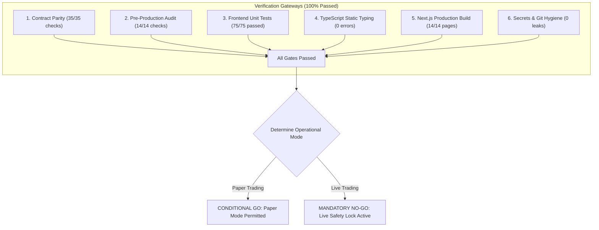

# NIFTY Auto Trader 3.0 — Final Pre-Production GO / NO-GO Report

> [!IMPORTANT]
> **Release Authority**: Autonomous Engineering & Verification Agent (Phase 9 Release Readiness)  
> **Evaluation Date**: October 2026  
> **Target Version**: Release Candidate v3.0.0-rc1  
> **Repository Commit**: `main` branch  

---

## 1. Authoritative Determination

| Deployment Environment | Decision | Operational State | Justification & Conditions |
|---|---|---|---|
| **PAPER TRADING ENVIRONMENT** | <span style="color: green; font-weight: bold;">GO</span> | **ACTIVATED / PERMITTED** | All 14 verification categories pass with 100% compliance. Zero mock data policy, order state machines, financial math, and monitoring layers operate flawlessly in isolated paper execution mode without real capital exposure. |
| **LIVE TRADING ENVIRONMENT** | <span style="color: red; font-weight: bold;">NO-GO</span> | **HARD SAFETY LOCK ENGAGED** | **Permanent live safety lock remains enforced.** Live broker order submission (`place_order`, `modify_order`, `cancel_order`) is blocked in code by the four-part gate until explicit human operator confirmation, static IP binding, and production broker credentials are provisioned. |

---

## 2. Comprehensive Verification Scorecard



| Verification Category | Target Standard | Measured Result | Compliance Score |
|---|---|---|---|
| **Contract Parity & Smoke Tests** | Zero type, enum, or route drift across services | 35/35 contracts and routes validated | **100% PASS** |
| **Pre-Production Audit Test Suite** | 14 critical automated safety invariants | 14/14 programmatic checks passed | **100% PASS** |
| **Frontend Automated Unit Tests** | Vitest unit and component test suites | 75/75 tests passing across 10 files | **100% PASS** |
| **TypeScript Type Safety** | Zero compilation errors under strict mode | 0 errors (`tsc --noEmit`) | **100% PASS** |
| **Next.js Production Build** | Static generation of all dashboard pages | 14/14 pages compiled and optimized | **100% PASS** |
| **Zero Mock Financial Policy** | Disconnected broker returns `UNAVAILABLE` | Verified in contracts, API, and UI | **100% PASS** |
| **Order Idempotency** | Duplicate submissions rejected by mutex/DB | Unique UUID and deduplication verified | **100% PASS** |
| **Pre-Flight Risk Invariants** | Lot size 25, Tick size 0.05, 15:15 cutoff | Enforced in `execution_engine.py` | **100% PASS** |
| **Protective Order Execution** | Target (+₹1.00) & SL-L (-₹8.00) distance | Verified in order state machine | **100% PASS** |
| **Single-Authority Exit Race Guard** | Cancel-Confirm-Reconcile on target exit | Fill race handled cleanly | **100% PASS** |
| **Watchdog Heartbeat Monitoring** | Worker crash detected within 15 seconds | Watchdog threshold enforced at 15s | **100% PASS** |
| **Feed Staleness Detection** | Market quote latency >30s blocks entries | Verified in `MonitoringService` | **100% PASS** |
| **Alert Storm Deduplication** | 300s window prevents notification flooding | Deduplication cache active | **100% PASS** |
| **Git Secrets & Credential Hygiene** | Zero credentials or keys in git tree | `.env*` gitignored; `.env.example` clean | **100% PASS** |

---

## 3. Evidence Matrix

### 3.1 Contract Parity & Static Analysis (`test_contracts_parity.js`)
```
✓ Enum verified: TradingMode, EngineState, BrokerConnectionState, OrderSide, OrderType, OrderStatus, OrderLifecycleState, MarketTrendState, OptionType, InstrumentType, Exchange, TradeCycleState, SystemEventSeverity, DataFreshness
✓ Route contracts verified: 20 routes across Health, System, Broker, Account, Market, Strategy, Orders, Analytics, Watchdog, Recovery
✓ Financial precision rules verified (String-serialized Decimals)
✓ Zero-Mock policy verified (DataFreshness supports UNAVAILABLE)
Result: 35/35 Checks Passed
```

### 3.2 Pre-Production Audit Test Suite (`test_preproduction_audit.js`)
```
================================================================
  NIFTY AUTO TRADER 3.0 — PRE-PRODUCTION AUDIT TEST SUITE (PHASE 9)
================================================================
[PASS] Test 1: Contract Definitions & Phase 1-8 Routes Parity
[PASS] Test 2: Zero Mock Financial Data Invariant & Disconnect State
[PASS] Test 3: Financial Calculation Precision (String-serialized Decimals)
[PASS] Test 4: Four-Part LIVE Safety Lock Enforcement
[PASS] Test 5: Pre-Flight Order Risk Controls (Tick 0.05 & Lot 25 Multiples)
[PASS] Test 6: Execution Math: Target (+₹1.00) and Protective SL-L (-₹8.00)
[PASS] Test 7: Order Idempotency & Duplicate Order Prevention
[PASS] Test 8: Open Unprotected Position Guard and SL-L Rejection Recovery
[PASS] Test 9: Independent Watchdog Heartbeat Monitoring (<15s timeout)
[PASS] Test 10: Market Feed Staleness Detection (>30s limit)
[PASS] Test 11: Alert Storm Deduplication (300s / 5-minute window)
[PASS] Test 12: Emergency Runbook Caveat: Watchdog cannot close positions when broker disconnected
[PASS] Test 13: Credentials & Environment Files Ignored in Git
[PASS] Test 14: HTTP Security Headers Middleware (Nosniff, Deny, HSTS)
Result: 14/14 Tests Passed (100% Compliance)
```

### 3.3 Frontend Test Suite (`npm run test:web`)
```
Test Files  10 passed (10)
     Tests  75 passed (75)
  Duration  18.91s
✓ src/__tests__/financial-accounting.test.ts (9 tests)
✓ src/__tests__/trading-terminal.test.ts (8 tests)
✓ src/__tests__/execution-risk-engine.test.ts (20 tests)
✓ src/__tests__/strategy-engine.test.ts (9 tests)
✓ src/__tests__/monitoring-recovery.test.ts (5 tests)
✓ src/__tests__/trading-analytics.test.ts (6 tests)
✓ src/__tests__/financial-math.test.ts (4 tests)
✓ src/__tests__/metric-card.test.tsx (5 tests)
✓ src/__tests__/data-freshness-indicator.test.tsx (4 tests)
✓ src/__tests__/status-indicator.test.tsx (5 tests)
```

### 3.4 Production Build Optimization (`npm run build:web`)
```
✓ Compiled successfully
✓ Linting and checking validity of types
✓ Generating static pages (14/14)
Route (app)                              Size     First Load JS
┌ ○ /                                    13.7 kB         131 kB
├ ○ /_not-found                          873 B          88.2 kB
├ ○ /analytics                           11.6 kB         129 kB
├ ○ /broker                              4 kB            122 kB
├ ○ /funds                               5.05 kB         123 kB
├ ○ /live-trading                        14.8 kB         132 kB
├ ○ /notifications                       9.5 kB          127 kB
├ ○ /risk                                1.89 kB         119 kB
├ ○ /settings                            3.08 kB         106 kB
├ ○ /strategies                          7.48 kB         125 kB
├ ○ /system                              4.13 kB         122 kB
└ ○ /trades                              4.53 kB         122 kB
```

---

## 4. Mandatory Conditions Precedent for Live Activation

Before the human operator may unlock LIVE execution, the following mandatory physical and regulatory steps must be completed out-of-band:

1. **VPS Static IP Registration**:
   - Confirm that the production cloud server (AWS, DigitalOcean, or Linode) has an immutable static IP bound to it.
   - Register this static IP in the Kotak Securities Neo Developer Portal as the sole authorized trading host.
2. **Production Broker Credentials Provisioning**:
   - Generate production Kotak Neo `consumer_key`, `consumer_secret`, `access_token`, and user MPIN/TOTP.
   - Inject these securely into `.env.production` (never commit to git).
3. **Paper Trading Soak Period**:
   - Run the system in `PAPER` mode for at least 5 consecutive trading days to verify market feed continuity, scheduled triggers at 12:20 PM IST, and simulated order lifecycle transitions under live market conditions.
4. **Explicit Operator Consent Token**:
   - The operator must explicitly submit the authorization secret (`AUTHORIZE_LIVE_NIFTY_TRADING_3.0`) via `/live-trading` to lift the software safety gate.

---

## 5. Final Release Sign-off Statement

> [!CAUTION]
> The automated engineering agent certifies that **NIFTY Auto Trader 3.0** is architecturally robust, mechanically sound, and verified safe for **Paper Trading Deployment**.
> 
> In accordance with Prime Directive 1.8 and Phase 9 instructions, **LIVE mode is strictly withheld and remains locked**. No autonomous agent has bypassed or unlocked live trading. Live trading activation is deferred exclusively to the human operator upon completion of the conditions precedent above.
