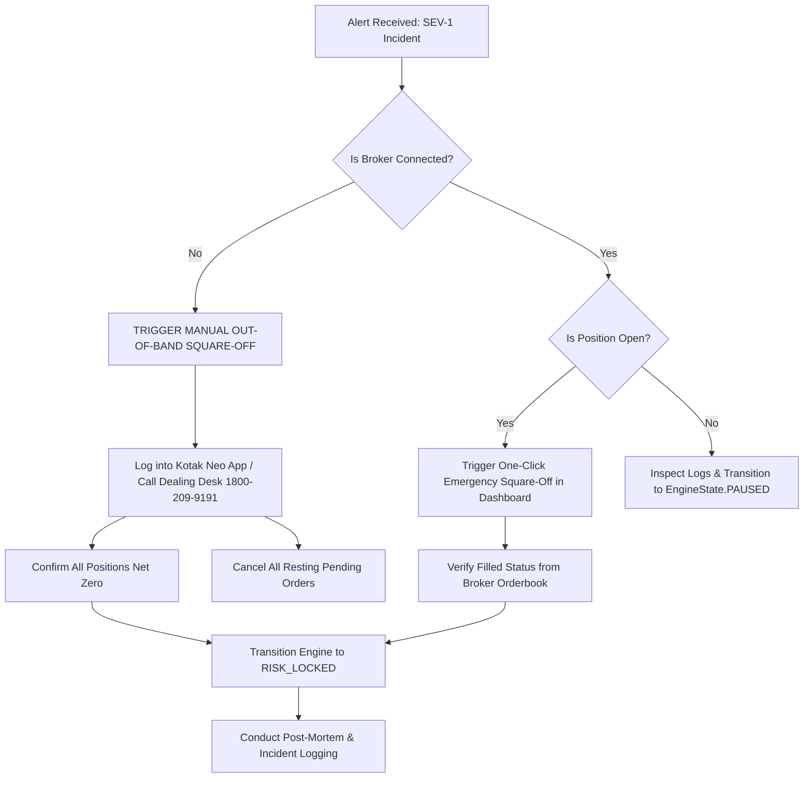

# NIFTY Auto Trader 3.0 — Incident Response Runbook

> [!CAUTION]
> **CRITICAL OPERATIONAL INVARIANT: The Watchdog CANNOT close open positions when broker connectivity is unavailable.**
> If Kotak Neo API is unreachable, degraded, or returns authentication failures, the automated watchdog engine has **zero execution capability** at the exchange. The human operator MUST immediately initiate manual square-off via Kotak Neo mobile app, web terminal, or dealing desk telephone.

---

## 1. Emergency Quick Reference Contacts

| Channel | Contact Point | Purpose | Availability |
|---|---|---|---|
| **Kotak Securities Dealing Desk** | `1800-209-9191` / `1800-222-299` | Emergency telephone square-off | Trading Days: 08:30 – 17:30 IST |
| **Kotak Neo Web Portal** | `https://neo.kotaksecurities.com` | Primary manual exit dashboard | 24 / 7 |
| **Kotak Neo Mobile App** | iOS / Android App | Fallback mobile execution | 24 / 7 |
| **System Admin Hotline** | Configured in `.env` (`ALERT_SMS_NUMBERS`) | VPS and server infrastructure | 24 / 7 |
| **NSE Emergency Square-off** | `022-26598100` | National Stock Exchange central desk | Trading Days |

---

## 2. Severity Classification Matrix

| Level | Severity | Definition & Impact | Response Target | Example Incident |
|---|---|---|---|---|
| **SEV-1** | **CRITICAL** | Direct financial exposure, active position without confirmed stop-loss, broker outage with open trade, worker crash during execution. | `< 60 Seconds` | Protective SL-L rejected by exchange; Worker dies while in BUY position. |
| **SEV-2** | **HIGH** | Feed stall, broker session expired, static-IP mismatch, missed scheduled strategy run. | `< 5 Minutes` | Market quote feed inactive for >30s; Kotak session token expired at 12:15 PM. |
| **SEV-3** | **MEDIUM** | Notification delivery failure, non-critical database latency, minor analytics reporting discrepancy. | `< 30 Minutes` | Telegram alert delivery HTTP 500; Contract-note reconciliation delta. |
| **SEV-4** | **LOW** | Minor UI rendering issue, non-blocking cosmetic error, log rotation warning. | Next Day | Chart tooltip formatting; CSV export filename alignment. |

---

## 3. Incident Response Golden Rules

1. **Protect Capital Above All Else**: If any doubt exists regarding position state, stop-loss validity, or broker connectivity, flatten open positions immediately.
2. **Never Allow Duplicate Buys**: A system restart or error recovery routine must NEVER execute an automatic duplicate BUY.
3. **Establish Safe State First**: If safe broker state cannot be verified, lock the engine in `EngineState.RISK_LOCKED` and block all new entries.
4. **Assume Unprotected Exposure on Broker Drop**: If broker connection is lost while a trade cycle is `IN_POSITION`, immediately assume the resting stop-loss may not execute as planned due to gap or liquidity events.
5. **Log Every Human Intervention**: All manual broker interventions must be recorded in system incidents for post-mortem auditing.

---

## 4. Operational Runbooks for Top Critical Incidents



### Runbook 1: Broker Disconnection with Open Position (SEV-1)
1. **Immediate Assessment**:
   - Check if Kotak Neo API reports `DISCONNECTED` or HTTP 5xx.
   - Note down the active open strike (e.g. `NIFTY 24500 CE`) and filled quantity.
2. **Out-of-Band Execution**:
   - Do NOT wait for automated reconnection.
   - Open Kotak Neo mobile app on smartphone or navigate to `https://neo.kotaksecurities.com`.
   - Go to **Portfolio > Positions**.
   - Select the open NIFTY option position and hit **Square Off (Market)**.
   - Go to **Orders > Open Orders** and click **Cancel All** to clear resting SL-L orders.
3. **Telephone Fallback**:
   - If internet connectivity is severed, dial Kotak Dealing Desk at `1800-209-9191`.
   - Provide client trading code and ask the dealer to square off all open derivatives positions at market.
4. **Platform Sync**:
   - Once broker connection restores, navigate to `/live-trading` on dashboard and click **Reconcile with Broker**.
   - Confirm local trade cycle marks `CLOSED`.

### Runbook 2: Protective Stop-Loss (SL-L) Placement Failure (SEV-1)
1. **Detection**:
   - Entry BUY order fills, but broker rejects the protective SL-L order (e.g., error `RMS: Margin insufficient` or `Exchange error`).
   - System triggers `PROTECTIVE_ORDER_FAILED` critical incident and enters `EngineState.RISK_LOCKED`.
2. **Automated Action**:
   - System immediately attempts emergency market square-off to eliminate naked long exposure.
3. **Operator Verification**:
   - Check the **Active Position** card on `/live-trading`.
   - If position is still showing open, immediately click the red **Emergency Square Off** button.
   - Verify on Kotak Neo app that net quantity is zero.

### Runbook 3: Watchdog Heartbeat Timeout / Worker Crash (SEV-1)
1. **Detection**:
   - Watchdog detects no heartbeat from trading worker for `> 15 seconds`.
   - System logs `WORKER_HEARTBEAT_TIMEOUT` and blocks all new entry orders.
2. **Action Procedure**:
   - Check VPS process status:
     ```bash
     systemctl status nifty-trading-worker.service
     journalctl -u nifty-trading-worker.service -n 50 --no-pager
     ```
   - If process crashed due to Out-Of-Memory (OOM) or unhandled exception:
     - Check if position was open prior to crash.
     - Inspect broker orderbook to ensure resting orders are intact.
     - Restart worker service:
       ```bash
       sudo systemctl restart nifty-trading-worker.service
       ```
   - The worker will automatically run `reconcile_startup_state()` upon initialization.

### Runbook 4: Market Feed Staleness (> 30s) (SEV-2)
1. **Detection**:
   - Market quotes have not updated in 30 seconds during active market hours (09:15–15:30 IST).
   - System logs `MARKET_FEED_STALE` and flags `DataFreshness.STALE` or `UNAVAILABLE`.
2. **Action Procedure**:
   - New entries are automatically blocked while feed is stale.
   - Check Kotak Neo market feed WebSocket connection status.
   - If Kotak feed is down, restart the feed consumer adapter or refresh broker session credentials via `/broker` page.

### Runbook 5: Cancel-Fill Race Condition During Target Exit (SEV-1)
1. **Detection**:
   - Target price (+₹1.00) is hit. System sends cancel request for resting SL-L order.
   - In transit, market abruptly drops and the exchange triggers and fills the stop-loss order before cancellation arrives.
2. **Automated Resolution**:
   - The `execute_target_exit_with_cancel_race_protection` routine inspects fill status.
   - When broker confirms SL-L filled, system halts target limit order submission to prevent accidental short position.
   - Cycle closes cleanly as `STOP_LOSS_FILLED_IN_RACE`.
3. **Operator Verification**:
   - Ensure target SELL order was NOT placed.
   - Net position must remain strictly 0.

---

## 5. Catalog of Analyzed Failure Modes (FM-01 through FM-18)

| Code | Failure Mode | Trigger Condition | Automated System Action | Operator Action Required |
|---|---|---|---|---|
| **FM-01** | Broker HTTP Timeout on Order | No response within 10s | Mark order UNKNOWN; Query broker orderbook | Check broker terminal; Reconcile |
| **FM-02** | Session Expiration in Market Hours | Kotak returns HTTP 401 | Freeze entries; Trip `SESSION_EXPIRED` | Re-authenticate via 2FA TOTP |
| **FM-03** | Stop-Loss Order Rejected | Exchange rejects SL-L | Trip `RISK_LOCKED`; Immediate square-off | Verify position is flat |
| **FM-04** | Market Feed Stale (>30s) | No tick received in 30s | Set `DataFreshness.STALE`; Block entries | Check market data subscription |
| **FM-05** | Worker Crash In-Position | Heartbeat >15s missed | Watchdog logs critical incident; Block new BUY | Restart service; Verify broker position |
| **FM-06** | Static IP Mismatch | Outgoing IP != whitelisted IP | Broker blocks auth / requests | Check VPS VPN / Elastic IP binding |
| **FM-07** | Duplicate Strategy Signal | Multiple signals generated | Idempotency registry rejects 2nd run | None (handled automatically) |
| **FM-08** | Incomplete 5-Min Candle | Candle closed early / missing ticks | EMA computation rejected; Skip cycle | Wait for next clean completed candle |
| **FM-09** | Option Strike Bid-Ask Illiquid | Spread > 10% or premium not ₹40-₹45 | Strike scanner skips strike | Strategy logs NO TRADE |
| **FM-10** | Target / Stop Cancel Race | SL-L fills while cancel in transit | Halt target SELL; Close trade at SL | Verify net position is 0 |
| **FM-11** | Partial Order Fill | Broker fills only partial lot | Engine waits or adjusts exit qty | Reconcile quantity |
| **FM-12** | Database Connection Loss | PostgreSQL pool exhausted | Engine halts in-memory; Fails safe | Check Postgres service health |
| **FM-13** | Alert Storm (Rapid Errors) | >10 alerts in 1 minute | Deduplication active; Group alerts | Investigate root cause alert |
| **FM-14** | Intraday Cutoff at 15:15 IST | Clock reaches 15:15 IST | Force market square-off all open cycles | Confirm all positions zero before 15:30 |
| **FM-15** | Daily Loss Limit Hit (₹3,000) | Cumulative loss >= ₹3,000 | Lock engine in `RISK_LOCKED` for the day | Review day trades; No further trading |
| **FM-16** | Unintended Naked Short Sell | Sell order exceeds long qty | Pre-flight risk blocks order immediately | None (hard-blocked) |
| **FM-17** | Exchange Trading Halt / Circuit | NSE halts index trading | Freeze trading engine; Set status HALTED | Await exchange resumption notice |
| **FM-18** | Corrupted Local State DB | Checksum / foreign key failure | Halt engine; Trigger manual recovery | Run `reconcile_startup_state()` |

---

## 6. Manual Recovery and Reset Checklist

When taking the system out of `EngineState.RISK_LOCKED` or `EngineState.ERROR`:

1. [ ] Check Kotak Neo web terminal to confirm zero open derivative positions.
2. [ ] Check Kotak Neo orderbook to confirm zero open, pending, or triggered orders.
3. [ ] Verify available account margin matches local balance.
4. [ ] Run Database startup reconciliation:
   ```bash
   curl -X POST http://localhost:8000/api/v1/recovery/reconcile \
     -H "Authorization: Bearer <ADMIN_TOKEN>"
   ```
5. [ ] Confirm watchdog reports `ALL_CLEAR` and worker heartbeat is green (<5s).
6. [ ] Transition engine state from `RISK_LOCKED` to `READY` via dashboard.
