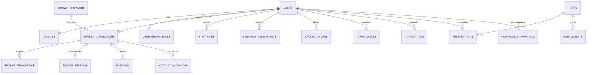

# Migration Impact Report & Audit (MIGRATION_IMPACT_REPORT.md)
## Phase 0–1: Safe Multi-Tenant SaaS Foundation

> Comprehensive architectural audit of single-user assumptions, hardcoded credentials, schema gaps, and backward-compatible migration plan for **NIFTY Auto Trader 3.0**.

---

## 1. Executive Summary & Audit Scope

This audit reviews all existing routes, database schemas, frontend components, background workers, broker integrations, and environment configurations in the NIFTY Auto Trader 3.0 repository prior to altering code for the multi-tenant SaaS transformation.

**Key Findings**:
1. **Single-User Ownership Invariant Missing in Storage**: While `users` and `user_preferences` exist in PostgreSQL, transactional entities (`strategies`, `orders`, `executions`, `trade_cycles`, `charge_entries`, `notification_channels`, `system_incidents`) lack a direct `user_id` foreign key.
2. **Unscoped Backend Queries**: Database queries in `orders.py`, `trade_cycles.py`, `analytics.py`, and `trades.py` fetch un-scoped table records, returning global data regardless of the authenticated requester's identity.
3. **Broker Adapter Singleton**: `app.broker.factory.get_broker_adapter()` returns a process-wide singleton initialized with static server credentials (`.env` variables `KOTAK_NEO_CONSUMER_KEY`, etc.), precluding multi-broker and multi-tenant isolation.
4. **Single-Leader Worker Lock**: Background automation currently relies on a single global Redis key (`autotrader:worker:leader`) and an in-memory `TradingEngine` state machine rather than per-user execution leases.

---

## 2. Audit of Existing Components & Single-User Assumptions

### 2.1 Database Entities & Schema Audit

| Existing Table | Current Ownership / Keys | Single-User Assumption / Flaw | Remediation Plan (Additive) |
| :--- | :--- | :--- | :--- |
| `users` | Primary key `id` | Assumes single operator default (`00000000-0000-0000-0000-000000000001`). | Retain table. Add `profiles` companion table for KYC & trader details. |
| `user_preferences` | FK `user_id -> users.id` (Unique) | Correctly scoped to user. | Retain table. Add default broker selection and notification preferences. |
| `broker_accounts` | FK `user_id -> users.id` | Hardcoded default broker `KOTAK_NEO`; unencrypted token fields. | Migrate to normalized `broker_connections` model with encrypted secrets and `broker_providers`. |
| `broker_connection_status`| FK `broker_account_id` | Single status row per broker account. | Retain as connection telemetry cache. |
| `strategies` | No `user_id` | Global strategy seeded at server startup with static ID (`1000...0001`). | Add nullable `user_id` (backfilled to default owner), then make non-nullable. |
| `strategy_versions` | FK `strategy_id` | Version increments are global rather than per-user. | Inherits user ownership via `strategy_id`. Add direct `user_id` index. |
| `strategy_runs` | FK `strategy_id` | Automation runs evaluated globally at 12:20 IST. | Add `user_id` foreign key to scope runs and execution intents. |
| `orders` | FK `broker_account_id` (Nullable) | No direct `user_id`; query returns last 50 global orders. | Add `user_id` foreign key with index. Scope all queries to authenticated user. |
| `executions` | FK `order_id -> orders.id` | Execution fills inherit order scoping. | Add direct `user_id` index for high-speed audit queries. |
| `trade_cycles` | Optional FK `strategy_run_id` | Query filters by symbol/date but not user; leaks cross-user P&L. | Add non-nullable `user_id` foreign key. Query must require `WHERE user_id = :uid`. |
| `charge_entries` | FK `trade_cycle_id` | Deductions linked to trade cycle. | Add direct `user_id` index. |
| `notification_channels` | No `user_id` | Global email/webhook channels receive alerts from all users. | Add non-nullable `user_id` foreign key. Scope alert dispatches. |
| `system_incidents` | No `user_id` | Global watchdog incidents leak broker errors across users. | Add optional `user_id` (system-wide vs user-specific incidents). |

---

### 2.2 Backend Services & Route Handlers Audit

1. **Authentication Gateway (`auth_service.py`)**:
   - Current: Falls back to `DEFAULT_OWNER_ID` when in development mode.
   - Multi-Tenant SaaS Requirement: Verify Supabase JWT header (`Authorization: Bearer <jwt>`). Extract `sub` as authenticated `user_id`. In development mode, auto-provision or load the profile of the verified user.
2. **Broker Factory (`factory.py`)**:
   - Current: `_adapter_instance: Optional[BrokerAdapter] = None` process singleton.
   - Multi-Tenant SaaS Requirement: Implement `BrokerConnectionManager` maintaining an active adapter instance cache indexed by `(user_id, broker_connection_id)`.
3. **Execution Engine (`execution_engine.py`)**:
   - Current: Validates order tick/lot against global session; paper fills update global records.
   - Multi-Tenant SaaS Requirement: Validate order against `user_id` broker account and active risk limits.
4. **Financial Accounting (`financial_accounting.py`)**:
   - Current: `get_filtered_trade_cycles` filters by date/state but ignores user.
   - Multi-Tenant SaaS Requirement: Inject `user_id` as mandatory first argument in all query builders.

---

### 2.3 Trading Worker & Scheduling Audit

1. **Worker State Machine (`engine.py`)**:
   - Current: Single `TradingEngine` instance holding `self.daily_realized_loss` and `self.today_trade_count`.
   - Multi-Tenant SaaS Requirement: Multi-runner manager maintaining isolated `TradingEngine` state machine contexts per active user/account.
2. **Heartbeat & Mutex (`heartbeat.py`)**:
   - Current: Global key `autotrader:worker:leader`.
   - Multi-Tenant SaaS Requirement: Per-user lease key `autotrader:worker:lease:{user_id}:{connection_id}` with 15s TTL.

---

## 3. Data Architecture Strategy: User-as-Tenant Boundary

In compliance with the directive:
> *"Use user IDs as tenant boundaries for individual trader accounts. Add an organization model only if there is a verified business requirement."*

We establish the individual trader (`users.id`) as the foundational tenant boundary. Every trading resource belongs to exactly one `user_id`.

---

## 4. Historical Data Preservation & Rollback Plan

### 4.1 Zero Data Loss Guarantee
1. **Existing User Preservation**:
   - The primary development owner (`00000000-0000-0000-0000-000000000001`, `trader@autotrader.local`) is formally persisted in `users` and `profiles`.
2. **Additive Foreign Key Backfill**:
   - Migration script adds `user_id` as **nullable**, backfills all existing rows (`strategies`, `orders`, `trade_cycles`, `charge_entries`, `account_snapshots`, etc.) with `00000000-0000-0000-0000-000000000001`, and then alters columns to **non-nullable** with foreign key constraints.
3. **Rollback Safety**:
   - Alembic migration `002_multi_tenant_saas.py` provides exact, tested `upgrade()` and `downgrade()` routines.
