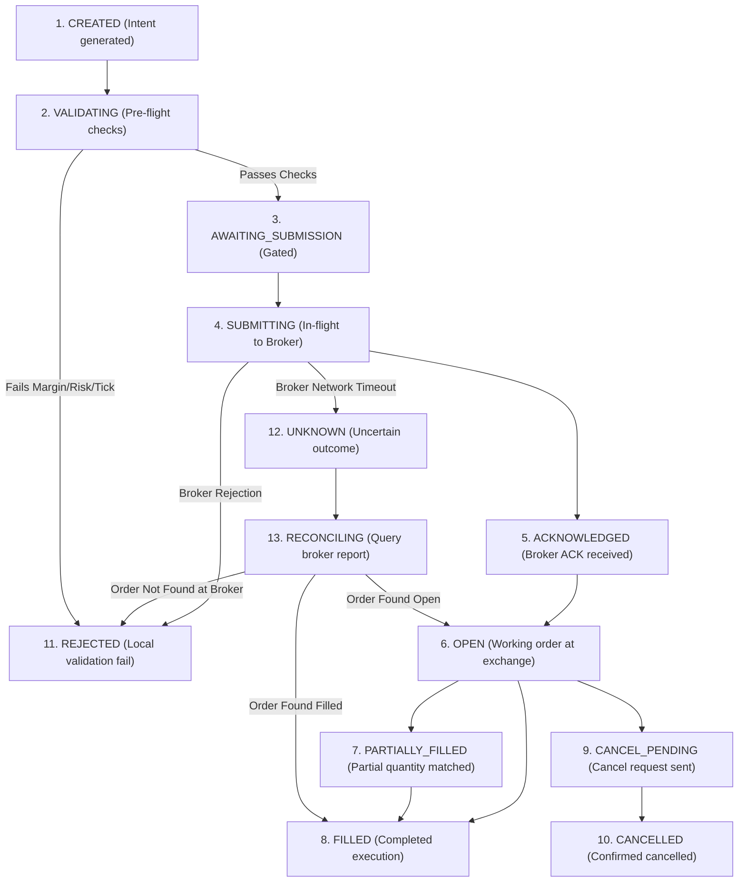

# Order Execution Lifecycle & Safety State Machine (ORDER_LIFECYCLE.md)

> Architectural specification of the 13-state deterministic order lifecycle, bracket safety model, reconciliation engine, and idempotency guarantees for **NIFTY Auto Trader 3.0**.

---

## 1. The 13-State Execution Lifecycle Machine

To prevent duplicate broker orders, untracked fills, and orphaned positions, every trading intent transitions strictly through the following 13 states:

---

## 2. Order Lifecycle State Definitions

| State | Scope & Operational Invariants | Terminal State? |
| :--- | :--- | :---: |
| **`CREATED`** | Trade intent instantiated with stable client UUID and idempotency key. No broker interaction yet. | No |
| **`VALIDATING`** | Pre-flight verification: tick size (0.05), lot size (25), margin required vs cash available, daily loss cushion, and statutory fee simulation. | No |
| **`AWAITING_SUBMISSION`** | Intent cleared by local risk gates; awaiting operator confirmation (or automated schedule trigger). | No |
| **`SUBMITTING`** | Dispatching signed API payload to broker via static VPS IP. Distributed lock acquired. | No |
| **`ACKNOWLEDGED`** | Broker returns initial HTTP 200/202 with assigned `brokerOrderId`. Order accepted into broker queue. | No |
| **`OPEN`** | Order verified resting on exchange order book (NSE/NFO). Awaiting price matching. | No |
| **`PARTIALLY_FILLED`** | Sub-lot or partial fill confirmed via broker trade feed. Remaining quantity stays open. | No |
| **`FILLED`** | Cumulative filled quantity equals requested quantity. Trade cycle promoted to `IN_POSITION`. | **Yes (Success)** |
| **`CANCEL_PENDING`** | Operator or worker emitted cancellation request. Awaiting broker confirmation. | No |
| **`CANCELLED`** | Cancellation confirmed by broker. Remaining unfilled quantity returned to zero. | **Yes (Aborted)** |
| **`REJECTED`** | Rejected by local validation gate, risk circuit, exchange tick rejection, or insufficient margin. | **Yes (Failed)** |
| **`UNKNOWN`** | Network timeout or HTTP 500 during submission. Order status indeterminate. | No |
| **`RECONCILING`** | Automated reconciliation routine actively polling broker tradebook/orderbook to determine true state before retrying. | No |

---

## 3. Idempotency & Network Failure Protocol

### 3.1 Prohibition of Blind Retries
> [!CAUTION]
> **Under no circumstances may an agent or service automatically resubmit an order that failed with an uncertain submission outcome (`UNKNOWN`).**
> If an HTTP request to Kotak Neo times out, the order may already have executed at the exchange. Automatically retrying creates severe duplicate financial exposure.

### 3.2 Reconciliation Protocol
When an order enters `UNKNOWN`:
1. The trading engine transitions into `RECONCILING`.
2. A distributed lock prevents new order dispatch.
3. The engine invokes `get_orders()` and `get_tradebook()` from Kotak Neo using the client-side correlation UUID (`guiOrdId` / `idempotencyKey`).
4. If the broker reports the order exists, it transitions to `ACKNOWLEDGED`, `OPEN`, or `FILLED`.
5. If the broker confirms the order does not exist after a 30-second backoff reconciliation window, it transitions safely to `REJECTED`.

---

## 4. Safety Model: Separation of Bracket Concerns

In automated options trading, bracket orders must not rely on fragile client-side assumptions:

1. **Target Order vs Protective Stop Order**:
   - Independent SELL orders do not automatically form an OCO (One-Cancels-the-Other) bracket unless natively supported and acknowledged by the broker API.
   - When Target is reached, the Stop order must be explicitly cancelled.
   - When Stop is triggered, the Target order must be explicitly cancelled.
2. **Actual Broker Position vs Strategy Intent**:
   - Strategy signals are hypothetical trading intents.
   - P&L and risk exposure are strictly derived from broker-reported physical positions.
3. **No Guaranteed Stop-Loss Fill**:
   - A Stop-Loss Limit order at the exchange can skip in fast gap-down markets if price jumps below the trigger limit.
   - The execution engine monitors slippage and applies market protection square-off if price breaches stop parameters.

---

## 5. Phase 5 Implementation: Execution Engine & Single-Authority Exit Manager

### 5.1 Single-Authority Exit Manager & Cancel-Confirm-Reconcile Sequence
Because Indian retail options brokers (including Kotak Neo) do not provide native exchange-level OCO bracket orders for options buying, placing simultaneous independent SELL orders at Target and Stop-Loss creates catastrophic risk: if the target fills, the stop order remains active at the exchange and can trigger later, turning the trader unintentionally SHORT into naked option writing.

To prevent this, the engine enforces a **Single-Authority Exit Manager**:
1. Upon confirmed BUY fill, **only ONE resting protective order** is placed at the broker: an exchange-side **Stop-Loss Limit (SL-L)** order.
2. When the target price is reached (or at mandatory 15:15 IST intraday exit, or on operator emergency halt):
   - **Step A (`CANCEL_PENDING`)**: A cancel request is dispatched for the resting SL-L order.
   - **Step B (`CANCELLED` Confirmation)**: The engine awaits explicit acknowledgment of cancellation from the broker.
   - **Step C (Position Reconciliation & Race Handling)**: The engine polls broker tradebook to verify whether the stop order was filled in the matching engine during transit before the cancel arrived:
     - If the stop *filled during the race*, the trade cycle is marked closed at Stop-Loss. Duplicate target order dispatch is strictly aborted.
     - If the stop *is confirmed cancelled* and the long position remains open, the engine submits the Target SELL limit order.
3. **Documented Unprotected Interval**:
   A deterministic latency window (typically 50ms to 200ms depending on broker network RTT) exists between the cancellation confirmation of the SL-L order and the exchange acceptance of the target SELL order. During this brief window, the position is unhedged. The autonomous worker continuously monitors quotes; if price drops rapidly during this window, an emergency market square-off is triggered.

### 5.2 Critical Disclaimer: SL-L Orders Do NOT Guarantee Execution
> [!CAUTION]
> **A Stop-Loss Limit (SL-L) order does NOT guarantee execution or a fixed maximum loss.**
> In fast-moving gap-down markets or illiquid strikes, if the market price jumps below both the trigger price and the limit price without matching any orders, the order will remain resting on the exchange order book as an unfilled limit order while losses continue to mount. 
> The autonomous Execution Engine actively tracks quote slippage: if the contract price drops 5% beyond the stop trigger while the order rests unfilled, the worker initiates emergency slippage protection square-off.

### 5.3 Protective SL-L Submission Failure (Emergency Procedure)
If the broker or exchange rejects the initial protective SL-L order following a BUY fill (due to margin, circuit limit, or API error):
1. The engine transitions immediately into `EngineState.RISK_LOCKED`.
2. All further automated entries are frozen.
3. An emergency risk-reduction procedure is executed immediately: a market/limit square-off order is submitted to flatten the unprotected open position.
4. A CRITICAL `SystemEvent` is logged and broadcast to supervisor channels.

### 5.4 Four-Part LIVE Safety Gate
To prevent accidental real-money execution, LIVE trading activation requires all four gates to be strictly verified:
1. **Explicit Operator Consent Token**: Required confirmation secret (`AUTHORIZE_LIVE_NIFTY_TRADING_3.0`).
2. **Active Broker Session**: Kotak Neo session state verified as `CONNECTED`.
3. **VPS Static-IP Compliance**: Egress IP matches the registered static IP at Kotak Neo.
4. **Approved Risk Configuration**: Both `maxDailyLoss` and `maxRiskPerTrade` must be populated with positive numerical thresholds in the active strategy version.
