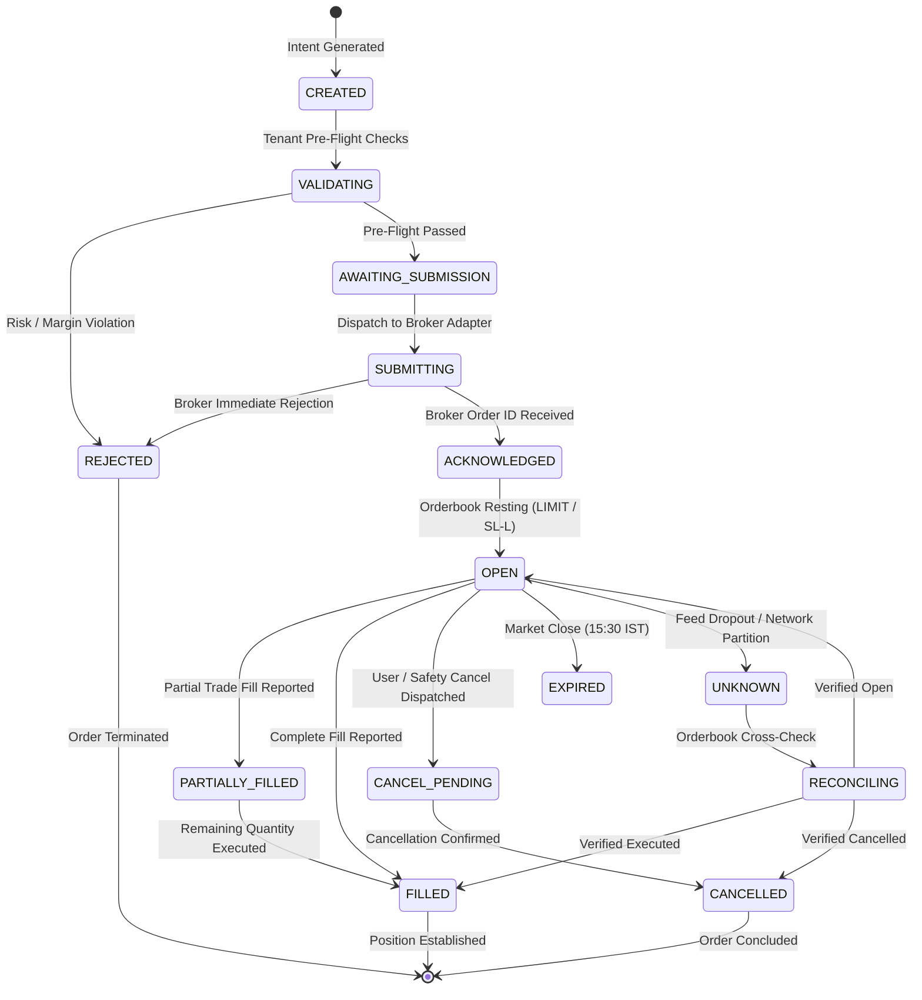

# Order Lifecycle & State Machine Specification (ORDER_LIFECYCLE.md)
## NIFTY Auto Trader 3.0 — Multi-Tenant, Multi-Broker Trading SaaS

> Authoritative order execution, risk validation, state transitions, and broker reconciliation for **NIFTY Auto Trader 3.0**.

---

## 1. Multi-Tenant Order State Machine

Every order placed manually or generated via strategy automation progresses through an explicit, validated state machine. Transitions are immutable and audited in PostgreSQL.

---

## 2. Tenant Pre-Flight Validation Checks (`VALIDATING`)

Before an order moves to `AWAITING_SUBMISSION`, the FastAPI gateway or worker executes mandatory checks scoped to the active tenant:

1. **Subscription & Feature Quota Check**:
   - Verify tenant subscription tier allows live execution (`subscription.live_execution_enabled == true`).
   - If plan is `FREE`, automatically route order exclusively into local Paper Trading simulation.
2. **Tenant Capital & Margin Check**:
   - Query tenant's broker account balance (`available_margin`).
   - Order cost = `quantity * price + buffer`. Assert `available_margin >= order_cost`.
3. **Daily Risk Allowance & Circuit Breaker**:
   - Verify tenant is not in `EngineState.RISK_LOCKED`.
   - Calculate cumulative daily realized loss. Assert `current_loss + risk_per_trade <= daily_loss_limit`.
4. **Lot Size & Tick Size Conformance**:
   - Assert `quantity % exchange_lot_size == 0` (e.g. 25 or 50 for NIFTY).
   - Assert `price % Decimal("0.05") == Decimal("0.00")`.
5. **Exchange Hours & Market State**:
   - Assert current time is within trading hours (09:15 AM - 15:30 PM IST) on an active exchange trading day.
6. **Double-Spend & Duplicate-BUY Guard**:
   - Query active trade cycles for this tenant. If an open position or unfulfilled entry order exists, reject duplicate BUY intents.

---

## 3. Order Idempotency Protocol

To prevent accidental duplicate orders resulting from network timeouts or UI double-clicks:
1. **Client Order ID Generation**:
   The client or strategy engine generates an idempotency key structured as:
   `autotrader:{tenant_id}:{trade_cycle_id}:{action}:{uuid}`
2. **Database Unique Constraint**:
   The `orders` table enforces a strict unique constraint on `idempotency_key`. A duplicate request returns the existing order record with `200 OK` rather than generating a secondary broker transaction.

---

## 4. Multi-Broker Normalized Order Translation

The canonical `AbstractBrokerAdapter` maps generic order parameters into broker-native structures:

| Canonical Field | Kotak Neo API | Zerodha Kite Connect | Upstox Pro v2 | Angel One SmartAPI |
| :--- | :--- | :--- | :--- | :--- |
| **Transaction Side** | `tt: "B"` / `"S"` | `transaction_type: "BUY"` | `transaction_type: "BUY"` | `transactiontype: "BUY"` |
| **Product Code** | `pc: "NRML"` | `product: "NRML"` | `product: "I"` / `"D"` | `producttype: "CARRYFORWARD"` |
| **Order Type** | `pt: "L"` / `"SL"` | `order_type: "LIMIT"` / `"SL"`| `order_type: "LIMIT"` / `"SL"`| `ordertype: "LIMIT"` / `"STOPLOSS_LIMIT"` |
| **Quantity** | `qt: str(qty)` | `quantity: int(qty)` | `quantity: int(qty)` | `quantity: str(qty)` |
| **Limit Price** | `pr: str(price)` | `price: float(price)` | `price: float(price)` | `price: str(price)` |
| **Trigger Price** | `tp: str(trigger)`| `trigger_price: float(tp)`| `trigger_price: float(tp)`| `triggerprice: str(tp)` |

---

## 5. Execution Target & Protective Stop-Loss (OCO Architecture)

> [!IMPORTANT]
> Indian broker retail APIs do not provide broker-native OCO (One-Cancels-the-Other) orders for intraday options. The platform manages targets and protective stops authoritatively:

1. **Target Calculation**:
   Upon fill confirmation of entry BUY, Target is calculated as:
   `target_price = average_fill_price + target_premium_move` (initially ₹1.00).
2. **Protective Stop-Loss (SL-L)**:
   Immediately upon entry fill, a broker-side `SL-L` order is submitted:
   `trigger_price = average_fill_price - initial_stop_loss` (initially ₹3.00),
   `limit_price = trigger_price - tick_size` (slippage protection).
3. **Exit Reconciliation**:
   - If market reaches Target price, the worker submits a LIMIT SELL order at target price and subsequently cancels the pending SL-L order upon fill.
   - If market triggers SL-L, the worker receives the fill callback and marks the trade cycle closed without dispatching an extraneous sell order.
