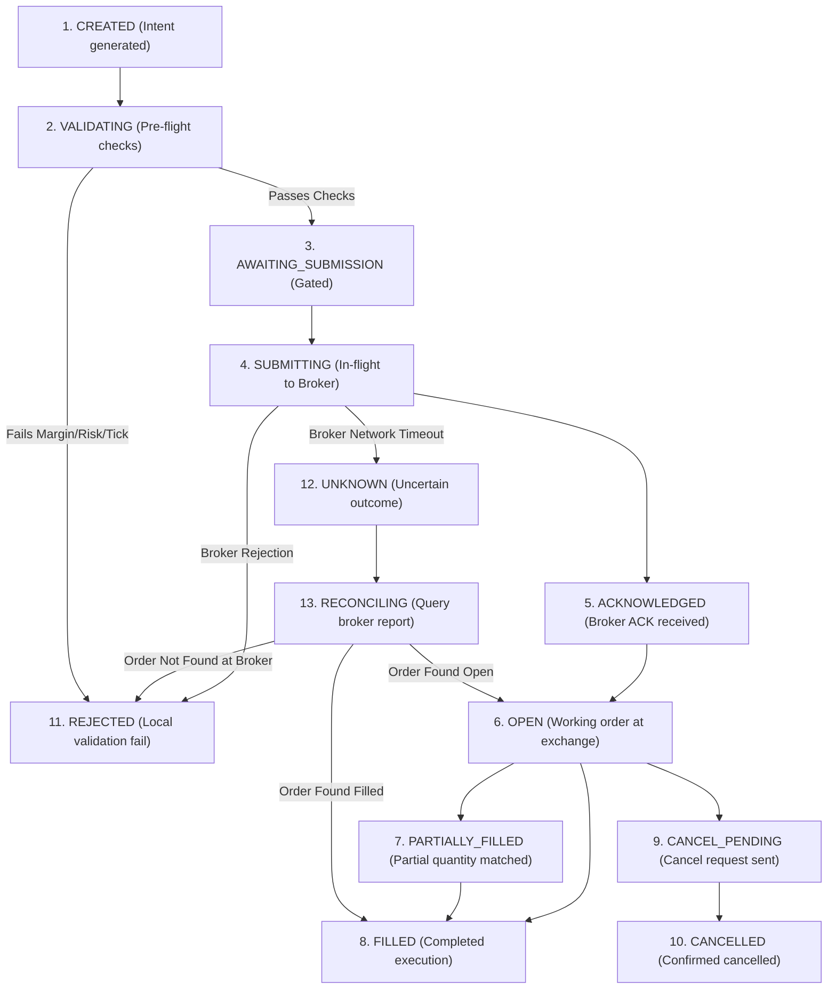

# Order Execution Lifecycle & Safety State Machine (ORDER_LIFECYCLE.md)

> Architectural specification of the 13-state deterministic order lifecycle, bracket safety model, reconciliation engine, and idempotency guarantees for **NIFTY Auto Trader 3.0**.

---

## 1. The 13-State Execution Lifecycle Machine

To prevent duplicate broker orders, untracked fills, and orphaned positions, every trading intent transitions strictly through the following 13 states:

---

## 2. Order Lifecycle State Definitions

| State | Scope & Operational Invariants | Terminal State? |
| :--- | :--- | :---: |
| **`CREATED`** | Trade intent instantiated with stable client UUID and idempotency key. No broker interaction yet. | No |
| **`VALIDATING`** | Pre-flight verification: tick size (0.05), lot size (25), margin required vs cash available, daily loss cushion, and statutory fee simulation. | No |
| **`AWAITING_SUBMISSION`** | Intent cleared by local risk gates; awaiting operator confirmation (or automated schedule trigger). | No |
| **`SUBMITTING`** | Dispatching signed API payload to broker via static VPS IP. Distributed lock acquired. | No |
| **`ACKNOWLEDGED`** | Broker returns initial HTTP 200/202 with assigned `brokerOrderId`. Order accepted into broker queue. | No |
| **`OPEN`** | Order verified resting on exchange order book (NSE/NFO). Awaiting price matching. | No |
| **`PARTIALLY_FILLED`** | Sub-lot or partial fill confirmed via broker trade feed. Remaining quantity stays open. | No |
| **`FILLED`** | Cumulative filled quantity equals requested quantity. Trade cycle promoted to `IN_POSITION`. | **Yes (Success)** |
| **`CANCEL_PENDING`** | Operator or worker emitted cancellation request. Awaiting broker confirmation. | No |
| **`CANCELLED`** | Cancellation confirmed by broker. Remaining unfilled quantity returned to zero. | **Yes (Aborted)** |
| **`REJECTED`** | Rejected by local validation gate, risk circuit, exchange tick rejection, or insufficient margin. | **Yes (Failed)** |
| **`UNKNOWN`** | Network timeout or HTTP 500 during submission. Order status indeterminate. | No |
| **`RECONCILING`** | Automated reconciliation routine actively polling broker tradebook/orderbook to determine true state before retrying. | No |

---

## 3. Idempotency & Network Failure Protocol

### 3.1 Prohibition of Blind Retries
> [!CAUTION]
> **Under no circumstances may an agent or service automatically resubmit an order that failed with an uncertain submission outcome (`UNKNOWN`).**
> If an HTTP request to Kotak Neo times out, the order may already have executed at the exchange. Automatically retrying creates severe duplicate financial exposure.

### 3.2 Reconciliation Protocol
When an order enters `UNKNOWN`:
1. The trading engine transitions into `RECONCILING`.
2. A distributed lock prevents new order dispatch.
3. The engine invokes `get_orders()` and `get_tradebook()` from Kotak Neo using the client-side correlation UUID (`guiOrdId` / `idempotencyKey`).
4. If the broker reports the order exists, it transitions to `ACKNOWLEDGED`, `OPEN`, or `FILLED`.
5. If the broker confirms the order does not exist after a 30-second backoff reconciliation window, it transitions safely to `REJECTED`.

---

## 4. Safety Model: Separation of Bracket Concerns

In automated options trading, bracket orders must not rely on fragile client-side assumptions:

1. **Target Order vs Protective Stop Order**:
   - Independent SELL orders do not automatically form an OCO (One-Cancels-the-Other) bracket unless natively supported and acknowledged by the broker API.
   - When Target is reached, the Stop order must be explicitly cancelled.
   - When Stop is triggered, the Target order must be explicitly cancelled.
2. **Actual Broker Position vs Strategy Intent**:
   - Strategy signals are hypothetical trading intents.
   - P&L and risk exposure are strictly derived from broker-reported physical positions.
3. **No Guaranteed Stop-Loss Fill**:
   - A Stop-Loss Limit order at the exchange can skip in fast gap-down markets if price jumps below the trigger limit.
   - The execution engine monitors slippage and applies market protection square-off if price breaches stop parameters.

---

## 5. Phase 3 Safety Lock Verification

In Phase 3:
- Market Scanner, Option Chain ingestion, Canonical EMA 9/21 Trend Analysis, and Pre-flight Trade Ticket Validation are **fully operational**.
- Live order execution remains **locked to PAPER simulation mode**. Live real-money broker order submission is disabled until the Phase 4 execution engine authorization.
