# Multi-Tenant SaaS Master Phase Roadmap & Governance Scorecard (PHASE_STATUS.md)

> Master phased development roadmap and governance tracking for transforming **NIFTY Auto Trader 3.0** into a Multi-Tenant, Multi-Broker Trading SaaS.

---

## 1. Master Phase Roadmap Overview

```mermaid
flowchart LR
    P1["Phase 1: Multi-Tenant Architecture & Database"] --> P2["Phase 2: Authentication & Workspaces"]
    P2 --> P3["Phase 3: Multi-Broker Abstraction & OAuth"]
    P3 --> P4["Phase 4: Per-Tenant Worker Leases & State Machines"]
    P4 --> P5["Phase 5: Tenant Accounting, Funds & Ledgers"]
    P5 --> P6["Phase 6: Subscriptions, Quotas & Billing"]
    P6 --> P7["Phase 7: Admin Console & Audit Monitoring"]
    P7 --> P8["Phase 8: Security Audit & SaaS Launch Gate"]
```

---

## 2. Phase-by-Phase Execution Plan

### Phase 1: Multi-Tenant Architecture & Database Foundation
- **Objective**: Establish relational multi-tenancy in PostgreSQL with zero disruption to existing records.
- **Key Tasks**:
  - Add `tenants`, `tenant_memberships`, and `subscriptions` tables via additive Alembic migration.
  - Backfill existing single-trader records into a default `"Primary Trading Desk"` tenant.
  - Add `tenant_id` foreign keys to all trading, strategy, accounting, and incident tables.
  - Update SQLAlchemy models and Pydantic schemas with `tenant_id`.
  - Update `@autotrader/api-contracts` with tenant types and enums.
- **Verification Gate**:
  - Alembic migrations upgrade and downgrade cleanly.
  - 100% test pass on existing contract parity and pre-production test suites.

### Phase 2: Authentication, Tenant Context & Workspaces
- **Objective**: Implement multi-user registration, Supabase Auth integration, and workspace switching.
- **Key Tasks**:
  - Build tenant context resolution middleware in FastAPI (`deps.get_current_tenant`).
  - Implement `/api/v1/tenants` and `/api/v1/auth/*` routes.
  - Build Tenant Switcher and Workspace Selector UI components in Next.js.
  - Enforce RBAC (OWNER, ADMIN, TRADER, VIEWER) permissions in API handlers.
- **Verification Gate**:
  - Cross-tenant intrusion tests verify that User A cannot read User B's tenant data.

### Phase 3: Multi-Broker Abstraction & OAuth Hub
- **Objective**: Expand beyond single-broker hardcoding to support a multi-broker ecosystem.
- **Key Tasks**:
  - Implement `AbstractBrokerAdapter` interface.
  - Refactor Kotak Neo into `KotakNeoAdapter`.
  - Add initial OAuth 2.0 broker adapters (Zerodha Kite, Upstox, Dhan).
  - Implement AES-256-GCM envelope encryption for stored broker credentials and tokens.
  - Build Multi-Broker Connection Wizard in UI.
- **Verification Gate**:
  - Mock and live broker adapter tests verifying genuine states (`READY`, `LOADING`, `ACCESS_PENDING`, etc.).

### Phase 4: Per-Tenant Worker Leases & State Machines
- **Objective**: Isolate background strategy automation and order execution per tenant.
- **Key Tasks**:
  - Replace single-worker global leader lock with per-tenant Redis leases (`autotrader:{tenant_id}:worker:lease`).
  - Instantiate independent state machine instances per tenant account.
  - Implement tenant-isolated 12:20 PM IST scheduled evaluations.
  - Validate pre-flight risk checks, double-spend prevention, and protective SL-L per tenant.
- **Verification Gate**:
  - Concurrent tenant simulation verifying Tenant A crash does not disrupt Tenant B execution.

### Phase 5: Tenant-Scoped Accounting, Charges & Portfolios
- **Objective**: Isolate portfolios, P&L calculations, and statutory fee reconciliations per tenant.
- **Key Tasks**:
  - Scope Trade Cycles, Executions, and Charge Entries strictly to active tenant.
  - Support broker-specific contract note formats and fee tariff structures.
  - Multi-tenant CSV/JSON analytics exports.
- **Verification Gate**:
  - Decimal precision verified; zero leakage between tenant balance sheets.

### Phase 6: Subscriptions, Quotas & Billing
- **Objective**: Implement subscription tiers and feature-gated capabilities.
- **Key Tasks**:
  - Build subscription plans (FREE, STARTER, PRO, ENTERPRISE).
  - Implement feature-gate middleware (broker limits, live execution gate, retention limits).
  - Add billing management UI with plan upgrade workflows.
- **Verification Gate**:
  - Quota enforcement verified via unit tests.

### Phase 7: Administrative Console & Multi-Tenant Audit
- **Objective**: Provide platform administrators with centralized oversight and compliance reporting.
- **Key Tasks**:
  - Platform-wide tenant management, status toggles, and incident stream.
  - Immutable audit trail ledger of all operator actions.
  - SEBI 5-year data retention compliance review.
- **Verification Gate**:
  - Admin RBAC security review.

### Phase 8: SaaS Hardening, Security Review & Production Release
- **Objective**: Comprehensive multi-tenant penetration testing, crash simulations, and Go/No-Go audit.
- **Key Tasks**:
  - End-to-end multi-user integration tests.
  - Static IP routing and network egress audit.
  - Final Go / No-Go scorecard.
- **Verification Gate**:
  - 100% compliance across all 25 Non-Negotiable Rules.

---

## 3. Governance Status Scorecard

| Phase | Description | Status | Target Date |
| :--- | :--- | :---: | :---: |
| **Contract Kickoff** | Master Development Contract, AGENTS.md, & Architecture Suite | **IN PROGRESS** | 2026-10-28 |
| **Phase 1** | Multi-Tenant Architecture & Database Foundation | **SCHEDULED** | Next Phase |
| **Phase 2** | Authentication, Tenant Context & Workspaces | **SCHEDULED** | — |
| **Phase 3** | Multi-Broker Abstraction & OAuth Hub | **SCHEDULED** | — |
| **Phase 4** | Per-Tenant Worker Leases & State Machines | **SCHEDULED** | — |
| **Phase 5** | Tenant-Scoped Accounting, Charges & Portfolios | **SCHEDULED** | — |
| **Phase 6** | Subscriptions, Quotas & Billing | **SCHEDULED** | — |
| **Phase 7** | Administrative Console & Multi-Tenant Audit | **SCHEDULED** | — |
| **Phase 8** | SaaS Hardening, Security Review & Production Release | **SCHEDULED** | — |
