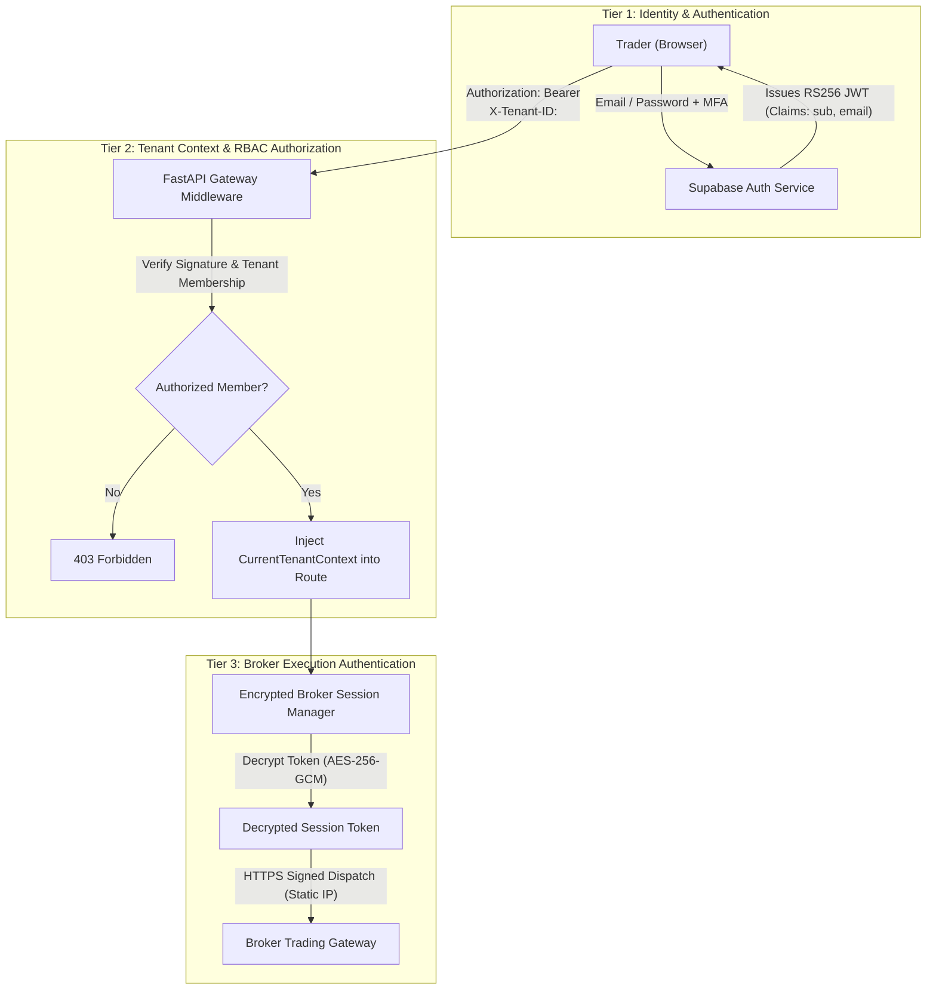
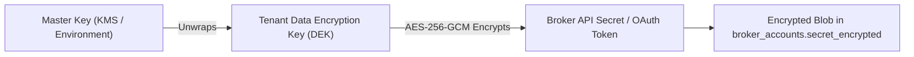

# Security, Cryptography & Compliance (SECURITY.md)
## NIFTY Auto Trader 3.0 — Multi-Tenant, Multi-Broker Trading SaaS

> Security architecture, cryptographic key management, tenant isolation, and regulatory boundaries for **NIFTY Auto Trader 3.0**.

---

## 1. Multi-Tenant Authentication Architecture

NIFTY Auto Trader 3.0 employs a **three-tier security model** establishing strict boundaries between Platform Authentication, Tenant Context Authorization, and Broker API Execution:



---

## 2. Secrets Management & Envelope Encryption

### 2.1 Envelope Encryption for Broker Credentials
In compliance with Indian cybersecurity guidelines and **Rule 18**, broker API secrets, consumer keys, and OAuth access tokens are encrypted at rest using **AES-256-GCM envelope encryption**:



1. **Master Key**: Stored securely in backend environment (`ENCRYPTION_MASTER_KEY_32B`) or cloud secret manager. Never committed to version control.
2. **Tenant Salt / Key Derivation**: Each tenant uses an independent derived subkey (HKDF) to encrypt broker credentials, guaranteeing that even in the catastrophic event of a database compromise, credentials cannot be decrypted without the master key.
3. **Zero Plaintext Logging**:
   - Backend logging middleware filters out all sensitive keys (`password`, `totp`, `secret`, `access_token`, `refresh_token`, `consumer_secret`).
   - Sentry / monitoring telemetry filters payload bodies for sensitive strings.

---

## 3. Row-Level & Tenant Data Isolation Invariants

1. **Database Schema Enforcement**:
   - Every transactional and financial table features a non-nullable `tenant_id` foreign key with cascade rules.
   - Database queries use explicit filter criteria:
     ```python
     stmt = select(Order).where(Order.tenant_id == current_tenant.id)
     ```
2. **Cross-Tenant Prevention Tests**:
   - Automated integration tests execute cross-tenant intrusion scenarios (e.g., Tenant A requesting Tenant B's order ID returns `404 Not Found` or `403 Forbidden`).
3. **Redis Key Namespacing**:
   - Keys are strictly partitioned: `autotrader:{tenant_id}:{resource}`.

---

## 4. Network Boundary Security

1. **Security Headers**:
   FastAPI middleware injects security headers on every response:
   - `X-Content-Type-Options: nosniff`
   - `X-Frame-Options: DENY`
   - `X-XSS-Protection: 1; mode=block`
   - `Referrer-Policy: strict-origin-when-cross-origin`
   - `Strict-Transport-Security: max-age=31536000; includeSubDomains` (Production)
2. **CORS Restrictions**:
   CORS is restricted strictly to verified frontend hostnames (`API_CORS_ORIGINS`).
3. **Static IP Outbound Routing**:
   Orders to static-IP bound brokers (Kotak Neo, Angel One) egress exclusively through verified, whitelisted static IP addresses.
