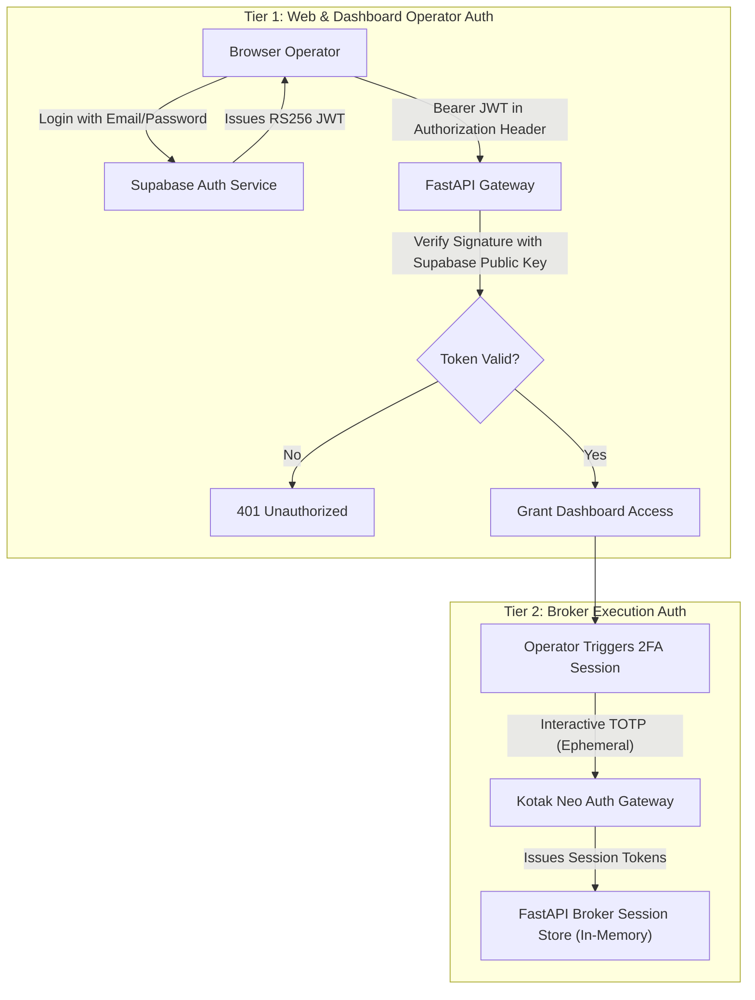

# Security, Cryptography & Compliance (SECURITY.md)

> Information security architecture, secrets management policy, network boundary protection, and financial transaction safeguards for **NIFTY Auto Trader 3.0**.

---

## 1. Authentication Architecture (Two-Tier Model)

NIFTY Auto Trader 3.0 enforces a strict separation between **Platform Access Authentication** and **Broker Order Execution Authentication**:



### 1.1 Supabase JWT Validation in FastAPI
- FastAPI validates incoming tokens using Supabase's public JWKS or configured JWT Secret.
- The user claims (`sub`, `email`, `role`) are injected into the request context via dependency injection.
- Role-based permissions:
  - `AUDITOR`: Read-only access to dashboard, events, and trade reports.
  - `OPERATOR`: Permitted to update strategy configurations and trigger broker 2FA.
  - `ADMIN`: Full system controls, user provisioning, and manual state override.

---

## 2. Secrets Management & Zero-Leakage Policy

### 2.1 Environmental Hygiene
1. **Server-Side Only**:
   - `KOTAK_NEO_CONSUMER_SECRET`, `KOTAK_NEO_PASSWORD`, and `SUPABASE_SERVICE_ROLE_KEY` are read exclusively by backend services.
   - None of these variables may carry the `NEXT_PUBLIC_` prefix, preventing Next.js client bundle inclusion.
2. **Zero Logging Guarantee**:
   - Log formatters enforce redaction filters:
     ```python
     SENSITIVE_KEYS = {"password", "secret", "totp", "consumer_secret", "access_token"}
     ```
   - Any log payload containing these keys automatically masks the values (`"***REDACTED***"`).
3. **TOTP Ephemerality**:
   - Time-based OTP codes are used in-flight to complete the session generation call to Kotak Neo.
   - Under no circumstances is a TOTP saved to database tables, cached in Redis, or written to disk.

---

## 3. Network Security & Perimeter Hardening

### 3.1 Static IP Whitelisting
- Automated trading traffic to Kotak Securities is bound to a dedicated Virtual Private Server (VPS) with a single static IPv4 address.
- Kotak Neo API servers reject API requests originating from unregistered dynamic IP addresses.
- An outbound pre-flight check validates external IP identity before initiating sessions.

### 3.2 CORS (Cross-Origin Resource Sharing)
- Cross-origin browser requests are restricted strictly to configured origins (e.g. `http://localhost:3000` for development or the official production domain):
  ```python
  app.add_middleware(
      CORSMiddleware,
      allow_origins=settings.API_CORS_ORIGINS,
      allow_credentials=True,
      allow_methods=["GET", "POST", "PUT", "DELETE", "OPTIONS"],
      allow_headers=["*"],
  )
  ```

### 3.3 HTTP Security Headers
All responses from the API Gateway and Next.js frontend include hardened HTTP security headers:
- `Content-Security-Policy (CSP)`: Disallows arbitrary inline script injection.
- `Strict-Transport-Security (HSTS)`: `max-age=63072000; includeSubDomains; preload`
- `X-Frame-Options`: `DENY` (prevents clickjacking attacks).
- `X-Content-Type-Options`: `nosniff`.
- `Referrer-Policy`: `strict-origin-when-cross-origin`.

---

## 4. Financial Transaction Security

### 4.1 Idempotency Keys
To safeguard against duplicate orders caused by network retries, connection drops, or operator double-clicks:
- Every execution intent and order is assigned a deterministic, UUID-based `idempotency_key`.
- The database schema enforces a `UNIQUE` constraint on `orders.idempotency_key`.
- If an order with the same key is submitted twice, the duplicate request is rejected before reaching the broker adapter.

### 4.2 Distributed Leader Lock
- Prevents multi-instance execution hazard ("split-brain").
- Redis mutex ensures that at any given millisecond, exactly **one worker process** can execute trading logic.

### 4.3 Rate Limiting
- Public and administrative endpoints are rate-limited using a sliding-window algorithm (default: 60 requests/minute per client).
- Broker polling routines maintain 5-second to 10-second cache intervals to prevent exceeding Kotak Neo's API transaction limits.
