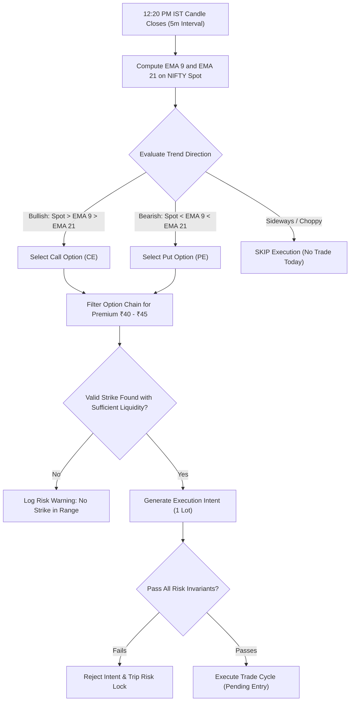
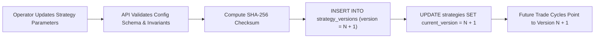

# Strategy Configuration & Risk Specification (STRATEGY_CONFIG.md)

> Formal technical specification of the default **12:20 PM IST NIFTY Options Strategy**, immutable versioning model, and financial risk governance rules for **NIFTY Auto Trader 3.0**.

---

## 1. Strategy Overview: 12:20 PM IST NIFTY Momentum Breakout

The default trading strategy is an intraday options buying strategy designed to capture afternoon momentum on the NIFTY 50 Index.

### 1.1 Strategy Core Rules & Execution Flow



### 1.2 Step-by-Step Rule Breakdown

1. **Trigger Time**: Precisely at **12:20:05 PM IST** (allowing 5 seconds for the 12:15–12:20 PM 5-minute candle to finalize and settle across exchange feeds).
2. **Trend Filter**:
   - Computes Exponential Moving Averages (EMA 9 and EMA 21) across consecutive 5-minute OHLCV candles of NIFTY 50 Spot.
   - **Bullish Signal**: Last Close > EMA 9 AND EMA 9 > EMA 21 (with slope > 0). Action: BUY CE.
   - **Bearish Signal**: Last Close < EMA 9 AND EMA 9 < EMA 21 (with slope < 0). Action: BUY PE.
   - **Sideways Filter**: If the absolute difference between EMA 9 and EMA 21 is less than 0.05% of spot price, or if the candle body is nested inside prior range, `sidewaysAction: "SKIP"` triggers and trading stops for the day.
3. **Dynamic Strike Selection**:
   - Queries nearest weekly expiry option chain.
   - Scans out-of-the-money (OTM) or at-the-money (ATM) strikes in the target direction whose Last Traded Price (LTP) falls in the range **₹40.00 to ₹45.00**.
   - If multiple strikes qualify, picks the strike closest to the midpoint (**₹42.50**).
4. **Position Sizing & Frequency**:
   - Quantity: Strictly **1 lot** (e.g., 25 units for NIFTY).
   - Frequency: Maximum **1 trade per calendar day**.
5. **Exit Conditions**:
   - **Target**: Profit target of +10 to +15 points premium move (+₹250 to +₹375 per lot).
   - **Stop-Loss**: Initial stop-loss fixed at -8 points premium move (-₹200 per lot).
   - **Time-Based Exit**: Hard auto-square-off at **15:15:00 PM IST** regardless of P&L.

---

## 2. Configuration Schema & Parameters

The strategy parameters are represented in JSON schema conforming to `StrategyConfig`:

```json
{
  "underlying": "NIFTY",
  "instrumentType": "OPTIONS",
  "entryTimeIST": "12:20",
  "premiumMin": "40.0000",
  "premiumMax": "45.0000",
  "targetPremiumMove": "12.0000",
  "initialStopLoss": "8.0000",
  "candleInterval": "5m",
  "trendIndicators": ["EMA_9", "EMA_21"],
  "maxTradesPerDay": 1,
  "lotCount": 1,
  "sidewaysAction": "SKIP",
  "maxRiskPerTrade": "1500.0000",
  "maxDailyLoss": "3000.0000",
  "minTradingFunds": "50000.0000",
  "maxBidAskSpread": "0.4000",
  "minLiquidity": 5000,
  "entryPriceTolerance": "1.0000",
  "maxDataAgeSeconds": 10,
  "maxOrderWaitSeconds": 30,
  "timeBasedExitIST": "15:15",
  "expirySelectionPolicy": "CURRENT_WEEK",
  "marketHolidayBehavior": "SKIP",
  "automatedRecoveryPolicy": "PAUSE"
}
```

---

## 3. Immutable Strategy Versioning Model

To ensure reproducible quantitative analysis and prevent post-trade configuration ambiguity:

1. **Table Structure**:
   - `strategies` contains mutable top-level metadata (`name`, `is_active`, `trading_mode`).
   - `strategy_versions` stores an append-only ledger of immutable JSON configurations with a cryptographic checksum (`SHA-256(config_json)`).
2. **Traceability**:
   - Every `trade_cycles` row has a foreign key `strategy_version_id` pointing to the exact version under which the trade was evaluated and executed.
3. **No In-Flight Edits**:
   - Modifying a strategy via the web UI or API generates a new version row (e.g. `version: 2`).
   - An active trade cycle running under `version: 1` continues to execute with version 1's parameters until closed.



---

## 4. Financial Risk Invariants & Live Trading Lock

### 4.1 Required Risk Limits
Before any strategy version can be marked `is_live_ready = true` or deployed to `TradingMode.LIVE`, the following risk parameters must be explicitly populated with positive numbers (null values are rejected):

| Parameter | Type | Validation Rule | Purpose |
| :--- | :--- | :--- | :--- |
| `maxRiskPerTrade` | `NUMERIC(15, 4)` | `> 0` and `<= 5000` | Hard cap on financial loss on any single trade cycle |
| `maxDailyLoss` | `NUMERIC(15, 4)` | `> maxRiskPerTrade` | Daily circuit breaker tripping worker into `RISK_LOCKED` |
| `minTradingFunds` | `NUMERIC(15, 4)` | `>= 25000` | Account must hold minimum unencumbered cash buffer |
| `maxBidAskSpread` | `NUMERIC(15, 4)` | `<= 1.00` | Rejects illiquid option strikes with wide slippage |
| `minLiquidity` | `INTEGER` | `>= 1000` | Minimum volume / market depth in contracts |
| `entryPriceTolerance` | `NUMERIC(15, 4)` | `<= 2.00` | Max slippage between trigger price and fill price |
| `maxDataAgeSeconds` | `INTEGER` | `<= 15` | Rejects stale market quotes |
| `timeBasedExitIST` | `VARCHAR(5)` | Valid HH:mm `<= 15:20` | Mandatory intraday square-off time |

---

### 4.2 The Live Trading Safety Lock

The system includes a multi-layered safety lock that permanently disables live order placement until all criteria are satisfied:

```python
# Conceptual safety gate in worker/engine.py
def assert_live_trading_authorized(strategy_config: StrategyConfig, engine_state: EngineState):
    # 1. Phase 1 Hard Boundary Check
    if CURRENT_PHASE == 1:
        raise SafetyLockViolation("Live execution permanently locked in Phase 1.")

    # 2. Complete Risk Parameter Validation
    if not strategy_config.is_live_ready():
        raise SafetyLockViolation(
            f"Strategy not live-ready: missing {strategy_config.missing_risk_fields()}"
        )

    # 3. Capital Solvency Invariant
    if current_available_cash < strategy_config.min_trading_funds:
        raise SafetyLockViolation("Available cash below minimum required threshold.")
```

> [!CAUTION]
> If a trade cycle attempts to breach `maxDailyLoss`, the execution engine transitions into `EngineState.RISK_LOCKED`, cancels all working orders, and blocks further trading until the next morning after manual supervisor sign-off.

---

## 5. Phase 4 Implementation: Automated Strategy Engine & Backtest Architecture

### 5.1 Market-Calendar-Aware Scheduling
- **Official NSE Holidays**: Hardcoded and extensible calendar of NSE holidays (Republic Day, Mahashivratri, Holi, Good Friday, Eid, Independence Day, Gandhi Jayanti, Diwali, Guru Nanak Jayanti, Christmas, etc.).
- **Weekend Invalidation**: Saturday and Sunday evaluations are immediately identified as non-trading days (`isTradingDay: false`).
- **Next Run Determination**: The scheduler computes the exact next trading day at 12:20:00 PM IST (`Asia/Kolkata`, UTC+5:30) and surfaces an accurate countdown in seconds.
- **Restart-Safe**: The scheduler computes targets dynamically from system time rather than stateful in-memory counters, ensuring resilience against process restarts.

### 5.2 Deterministic Signal Evaluation (Completed 5m Candles)
1. **Candle Count**: Requires a minimum of 22 completed 5-minute candles from the day's market open (09:15 to 12:20 IST corresponds to candle index 36, minimum requirement: 22 bars for recursive EMA 21 stabilization).
2. **Recursive EMA Calculation**:
   $$\text{EMA}_t = \left(\text{Close}_t \times \frac{2}{N + 1}\right) + \left(\text{EMA}_{t-1} \times \left(1 - \frac{2}{N + 1}\right)\right)$$
   Where $N = 9$ or $N = 21$.
3. **Sideways Band ($\pm 2.0$ points)**:
   If $|\text{EMA}_9 - \text{EMA}_{21}| \le 2.0$, trend is declared `SIDEWAYS` and `NO_TRADE` is returned with skip reason `"EMA 9 and EMA 21 within sideways band"`.
4. **Candle Confirmation**:
   - Bullish: $\text{Close} > \text{EMA}_9 > \text{EMA}_{21}$ and green bar ($\text{Close} \ge \text{Open}$). Action: Select `CE`.
   - Bearish: $\text{Close} < \text{EMA}_9 < \text{EMA}_{21}$ and red bar ($\text{Close} \le \text{Open}$). Action: Select `PE`.
   - Unconfirmed: If price breaches EMA opposite to candle color, evaluation safely skips.

### 5.3 Executable-Ask Premium Scanner
- Option chain is queried for the nearest weekly expiry.
- Strikes in the selected direction are filtered strictly by **executable ask price** ($40.00 \le \text{Ask} \le 45.00$).
- Bid-ask spread limit ($\le 0.80$) and minimum liquidity ($\ge 500$ contracts) are enforced.
- The strike closest to ₹42.50 midpoint is selected as candidate.

### 5.4 Duplicate Daily Run Prevention
- Every evaluation checks the audit ledger `strategy_runs` for an existing record matching `(strategy_id, trade_date)`.
- If already evaluated, the engine returns `ALREADY_EVALUATED` and forbids duplicate order intent creation.
- Live order submission remains permanently gated (`LIVE` lock maintained).

### 5.5 Zero-Lookahead Backtesting Engine
- Data is partitioned chronologically by trading day.
- For each day, candles are strictly sliced up to 12:20 PM IST prior to indicator calculation, completely preventing lookahead bias.
- Real-world statutory fee schedules (Brokerage ₹40, STT 0.1%, Exchange Turnover, SEBI turnover fees, GST 18%, Stamp Duty 0.003%) are modeled per trade, revealing that micro-moves below 3 points are net-negative.
