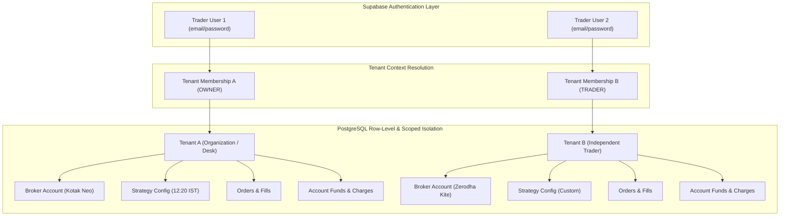
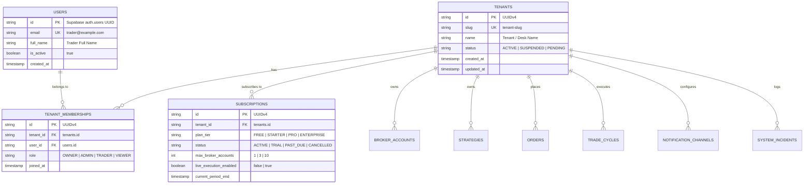

# Multi-Tenancy Architecture Specification (TENANCY.md)

> Technical architectural specification for **NIFTY Auto Trader 3.0** — Multi-Tenant, Multi-Broker Trading SaaS.

---

## 1. Tenancy Model Overview

NIFTY Auto Trader 3.0 is an institutional-grade SaaS platform designed for independent retail traders and trading desks. The platform enforces **strict logical tenant isolation** across storage, compute, broker sessions, order execution, and supervisory monitoring.



---

## 2. Core Tenancy Domain Entities

### 2.1 Entity Relationship Diagram



### 2.2 Roles and Permissions Matrix (RBAC)

| Capability / Resource | OWNER | ADMIN | TRADER | VIEWER |
| :--- | :---: | :---: | :---: | :---: |
| **View Dashboard, Telemetry & P&L** | Yes | Yes | Yes | Yes |
| **View Reconciled Trade Cycles & Ledgers** | Yes | Yes | Yes | Yes |
| **Connect / Disconnect Broker Account** | Yes | Yes | No | No |
| **Configure Strategy Rules & Targets** | Yes | Yes | Yes | No |
| **Execute Manual Orders (Paper / Live)** | Yes | Yes | Yes | No |
| **Toggle Automated Engine State** | Yes | Yes | Yes | No |
| **Acknowledge System Incidents** | Yes | Yes | Yes | No |
| **Configure Webhook / Email Alerts** | Yes | Yes | No | No |
| **Manage Billing & Plan Subscriptions** | Yes | No | No | No |
| **Invite / Remove Tenant Members** | Yes | Yes | No | No |

---

## 3. Row-Level & Backend Scoping Invariants

### 3.1 Strict Foreign Key Inheritance
Every transactional and financial table must possess a non-nullable `tenant_id` foreign key referencing `tenants.id`:
- `broker_accounts.tenant_id`
- `account_snapshots.tenant_id`
- `position_snapshots.tenant_id`
- `orders.tenant_id`
- `executions.tenant_id`
- `trade_cycles.tenant_id`
- `charge_entries.tenant_id`
- `strategies.tenant_id`
- `strategy_versions.tenant_id`
- `strategy_runs.tenant_id`
- `execution_intents.tenant_id`
- `risk_events.tenant_id`
- `system_incidents.tenant_id`
- `notification_channels.tenant_id`

### 3.2 Authoritative Tenant Context Resolution (Backend)
1. **JWT Verification**: FastAPI verifies the Supabase Auth JWT header (`Authorization: Bearer <token>`).
2. **Context Injection**: The active `tenant_id` is derived from:
   - Primary: The user's active tenant membership retrieved from the database.
   - Header Override (for multi-desk operators): `X-Tenant-ID` header, strictly validated against `tenant_memberships` to verify that `user_id` has an active role in that specific tenant.
3. **Database Scoping Invariant**:
   ```python
   # Backend query invariant: Always scoped to resolved tenant
   query = select(TradeCycle).where(
       TradeCycle.tenant_id == current_tenant.id,
       TradeCycle.id == cycle_id,
   )
   ```
4. **Prohibition of Client-Supplied Tenant Filters**: The browser cannot bypass tenant boundaries by providing arbitrary `tenant_id` parameters in query strings or body payloads; any discrepancy triggers a `403 Forbidden` security event.

---

## 4. Subscription Tiers & Feature Gates

| Feature / Limit | FREE (Paper Only) | STARTER | PRO | ENTERPRISE |
| :--- | :---: | :---: | :---: | :---: |
| **Paper Trading Simulation** | Unlimited | Unlimited | Unlimited | Unlimited |
| **Supported Brokers** | Any (Simulated) | 1 Active Broker | Up to 3 Brokers | Unlimited |
| **Active Strategy Configurations** | 1 Strategy | 2 Strategies | 5 Strategies | Unlimited |
| **Execution Speed Tier** | Standard | High Priority | Low-Latency Dedicated | Custom Colocation |
| **Live Order Execution Gate** | Disabled | Enabled (Post-Audit) | Enabled (Post-Audit) | Enabled (Post-Audit) |
| **Historical Data Retention** | 30 Days | 1 Year | 5 Years (SEBI Compliant) | Unlimited |
| **Alert Channels** | In-App Only | Email + In-App | Telegram + Webhook | Dedicated PagerDuty |
| **Dedicated Outbound IP** | Shared / NAT | Single Fixed IP | Dedicated Static IP | Multi-Zone Static IPs |

---

## 5. Cross-Tenant Leakage Defenses

1. **Redis Key Namespacing**:
   All cache keys, locks, and publication channels must be prefixed with the tenant ID:
   ```
   autotrader:{tenant_id}:broker:session
   autotrader:{tenant_id}:worker:lease
   autotrader:{tenant_id}:quote:nifty
   ```
2. **Per-Tenant Execution Leases**:
   The background trading worker processes each tenant's strategy evaluation in an isolated execution sandbox. A crash, rate-limit rejection, or broker failure in Tenant A never impacts Tenant B.
3. **Audit Trail Verification**:
   All state transitions, credential changes, and order dispatches are logged to `audit_logs` with both `tenant_id` and `user_id`.
