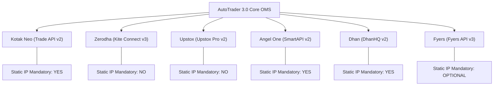

# Broker Capabilities & Compliance Matrix (broker-capabilities.md)
## NIFTY Auto Trader 3.0 — Multi-Broker Technical Specification

> **Specification Version**: 1.0.0  
> **Target Market**: Indian Equities & NSE Derivatives (NIFTY 50 Options)

---

## 1. Overview of Supported Brokers

AutoTrader 3.0 interfaces with 6 major Indian stockbrokers through a unified adapter contract (`BrokerAdapter`). Each broker integration operates under specific regulatory, architectural, and network constraints.

---

## 2. Comprehensive Broker Capability Comparison

| Capability | Kotak Neo | Zerodha Kite | Upstox Pro | Angel One | DhanHQ | Fyers |
| :--- | :--- | :--- | :--- | :--- | :--- | :--- |
| **API Version** | Trade API v2 | Kite Connect v3 | API v2 | SmartAPI v2 | DhanHQ v2 | API v3 |
| **Auth Protocol** | TOTP + MPIN / Password | OAuth 2.0 (Login URL) | OAuth 2.0 (PKCE) | TOTP + Password / MPIN | Access Token + Secret | OAuth 2.0 Flow |
| **Broker-Hosted Portal?** | Limited / API-driven | **Yes** (Kite Login) | **Yes** (Upstox Login) | Limited / API-driven | **Yes** (Dhan Web) | **Yes** (Fyers Login) |
| **Daily Session Expiry** | 24h / EOD | 06:00 AM IST Daily | 24h / EOD | 24h / EOD | 30 Days (Token) | 24h / EOD |
| **Re-auth Method** | Interactive / MPIN | Browser OAuth Flow | Browser OAuth Flow | TOTP Exchange | Token Refresh | OAuth Exchange |
| **Static IP Mandatory?** | **Yes** (Whitelist Portal) | No (App-bound) | No (App-bound) | **Yes** (IP Binding) | **Yes** (API Whitelist) | Optional |
| **Order Placement Limit** | 10 req / sec | 10 req / sec | 25 req / sec | 10 req / sec | 10 req / sec | 10 req / sec |
| **Quote Request Limit** | 1 req / sec (REST) | 3 req / sec | 10 req / sec | 3 req / sec | 5 req / sec | 5 req / sec |
| **WebSocket Feed Type** | Binary / JSON Ticks | Binary Packets | Protobuf WebSocket | Binary / Text Ticks | Binary Packets | Binary Protobuf |
| **Order Types Supported**| `L`, `SL`, `MKT` (Eq) | `LIMIT`, `SL`, `SL-M` | `LIMIT`, `SL`, `SL-M` | `LIMIT`, `STOPLOSS_LIMIT` | `LIMIT`, `SL` | `LIMIT`, `SL-L` |
| **Options Market Orders**| **Disallowed** | **Disallowed** | **Disallowed** | **Disallowed** | **Disallowed** | **Disallowed** |
| **Products Supported** | `NRML`, `MIS`, `CNC` | `NRML`, `MIS`, `CNC` | `NRML`, `MIS`, `CNC` | `NRML`, `INTRADAY`, `DELIVERY` | `NRML`, `INTRADAY`, `CNC` | `INTRADAY`, `MARGIN`, `CNC` |
| **Postback Webhooks?** | No (Polling required)| **Yes** (Kite Postbacks)| **Yes** (Webhooks) | No (Polling required) | **Yes** (Webhooks) | **Yes** (Webhooks) |

---

## 3. Order Type & Safety Invariants

### 3.1 Strict Prohibition of Options Market Orders
> [!CAUTION]
> In accordance with Indian exchange risk regulations and market depth protection rules, **all index and equity options orders must be submitted strictly as LIMIT or STOP-LOSS LIMIT (SL-L)**. Market orders (`MKT`) on options contracts are blocked by both broker gateways and the AutoTrader risk engine to prevent execution against empty order books and extreme slippage.

### 3.2 Protective Stop-Loss Limit (SL-L) Mechanics
- For a BUY position entry:
  - Protective stop order is a **SELL SL-L**.
  - `trigger_price`: The price at which the order becomes active in the broker book.
  - `limit_price`: Must be set with a safety buffer (e.g., ₹1.00 to ₹2.00 below trigger price for NIFTY options) to ensure fill execution during fast downward momentum.

---

## 4. Error Code Normalization & Handling

Each broker emits proprietary error strings. AutoTrader 3.0 translates these into normalized system errors:

| Broker Error Code / Message | Normalized System Error Code | Recommended Recovery Action |
| :--- | :--- | :--- |
| `TokenException` (Zerodha) / `401 Unauthorized` | `SESSION_EXPIRED` | Prompt user for interactive re-authentication. |
| `InsufficientFunds` / `Margin shortfall` | `INSUFFICIENT_MARGIN` | Reject order pre-flight; do not retry. |
| `TooManyRequests` / `Rate Limit Exceeded` (429) | `RATE_LIMITED` | Apply exponential backoff (delay 1.0s, 2.0s, 4.0s). |
| `NetworkException` / Socket Timeout | `SUBMISSION_UNKNOWN` | **DO NOT RETRY**. Query broker orderbook by `client_order_id` to reconcile state. |
| `InvalidTickSize` / Price not aligned to 0.05 | `INVALID_PRICE_TICK` | Round price to nearest 0.05 multiple before resubmission. |
| `OrderBlocked` / Security in ban period | `INSTRUMENT_RESTRICTED` | Display exchange ban notification; halt strategy. |
| `StaticIPMismatch` / Egress IP unlisted | `BLOCKED_EXTERNAL_SETUP` | Direct user/admin to whitelist static IP in broker portal. |

---

## 5. Broker Setup & Credential Requirements

### 5.1 Kotak Neo
1. **Prerequisites**: Kotak Securities trading account with Neo Trade API enabled via Kotak API Developer portal.
2. **Credentials Required**: Consumer Key, Consumer Secret, Mobile Number, Password, and MPIN.
3. **Network**: Dedicated static egress IP must be registered in the Kotak Neo API console.

### 5.2 Zerodha Kite Connect
1. **Prerequisites**: Zerodha trading account with active Kite Connect Developer App (`kite.trade`).
2. **Credentials Required**: API Key and API Secret.
3. **Handshake**: Browser redirects to `https://kite.zerodha.com/connect/login?api_key=...`. User logs in; Zerodha redirects to registered callback with `request_token`. Backend exchanges token with SHA-256 checksum (`sha256(api_key + request_token + api_secret)`).

### 5.3 Upstox Pro
1. **Prerequisites**: Upstox Developer account (`developer.upstox.com`).
2. **Credentials Required**: Client ID (API Key), Client Secret, Redirect URI.
3. **Handshake**: Standard OAuth 2.0 PKCE flow. Exchanged server-side for access token.

### 5.4 Angel One SmartAPI
1. **Prerequisites**: Angel One trading account with SmartAPI registered application.
2. **Credentials Required**: API Key, Client Code, Password/MPIN, and TOTP Secret for automated 2FA.
3. **Network**: Static IP binding required in the SmartAPI developer dashboard.

### 5.5 DhanHQ
1. **Prerequisites**: Dhan trading account with API access enabled via Dhan Web portal.
2. **Credentials Required**: Client ID and 30-day Access Token.
3. **Network**: Static IP whitelist required in Dhan API settings.

### 5.6 Fyers
1. **Prerequisites**: Fyers trading account with Fyers API v3 app created in Fyers API dashboard.
2. **Credentials Required**: App ID, Secret Key, and Redirect URI.
3. **Handshake**: OAuth 2.0 authorization code exchange.
