# Production MVP Implementation Plan (implementation-plan.md)
## NIFTY Auto Trader 3.0 — Phased Execution Roadmap

> **Plan Version**: 1.0.0  
> **Target**: Production-Oriented MVP with Genuine Multi-Broker Functionality

---

## 1. Execution Philosophy & Sequence

The implementation proceeds in strict sequential phases. Each phase builds upon verified invariants and passes explicit acceptance gates before advancing.

```mermaid
flowchart LR
    P0["Phase 0: Audit & Baseline"] --> P1["Phase 1: Auth & User Mgmt"]
    P1 --> P2["Phase 2: Canonical Multi-Broker"]
    P2 --> P3["Phase 3: Connection Flow"]
    P3 --> P4["Phase 4: Live Dashboard"]
    P4 --> P5["Phase 5: OMS & Reconcile"]
    P5 --> P6["Phase 6: Risk Engine"]
    P6 --> P7["Phase 7: Strategy Engine"]
    P7 --> P8["Phase 8: Market Data"]
    P8 --> P9["Phase 9: Analytics"]
    P9 --> P10["Phase 10: Notifications"]
    P10 --> P11["Phase 11: DB & Multi-Tenant"]
    P11 --> P12["Phase 12: Security"]
    P12 --> P13["Phase 13: Deployment"]
    P13 --> P14["Phase 14: E2E Tests"]
    P14 --> P15["Phase 15: Final Release"]
```

---

## 2. Phase-by-Phase Milestones & Deliverables

### Phase 1 — Authentication and User Management
- **Deliverables**:
  - Integrate Firebase Auth server-side token validation in `services/api/app/routers/deps.py`.
  - Persist user profiles, risk preferences, and tenant settings in PostgreSQL.
  - Implement role-based access control (`SUPER_ADMIN`, `USER`, `SUPPORT_READ_ONLY`) on all protected endpoints.
  - Reject client-submitted `tenant_id` in favor of cryptographic session context.
- **Acceptance Gate**: Tests verify that authenticated requests cannot access another tenant's profile or data.

### Phase 2 — Canonical Multi-Broker Architecture
- **Deliverables**:
  - Enforce the canonical `BrokerAdapter` interface across all 6 brokers:
    - Kotak Neo (`KotakNeoAdapter`)
    - Zerodha Kite Connect (`ZerodhaKiteAdapter`)
    - Upstox Pro (`UpstoxAdapter`)
    - Angel One SmartAPI (`AngelOneAdapter`)
    - DhanHQ (`DhanAdapter`)
    - Fyers (`FyersAdapter`)
  - Normalize data contracts for funds, positions, holdings, orders, trades, and quotes.
- **Acceptance Gate**: Contract tests pass with zero mock data leakage and correct error code translation.

### Phase 3 — Full Broker Connection Flow
- **Deliverables**:
  - Implement official OAuth 2.0 handshake for Zerodha, Upstox, Dhan, and Fyers.
  - Implement TOTP and MPIN validation workflow for Kotak Neo and Angel One.
  - Encrypt all stored credentials using AES-256-GCM envelope encryption.
  - Enforce explicit connection states: `CONNECTED`, `DISCONNECTED`, `CONNECTING`, `REAUTH_REQUIRED`, `TOKEN_EXPIRED`, `PERMISSION_DENIED`, `BROKER_UNAVAILABLE`, `BLOCKED_EXTERNAL_SETUP`.
- **Acceptance Gate**: Real authenticated health checks must succeed before a connection is labeled `CONNECTED`.

### Phase 4 — Live Dashboard Backend
- **Deliverables**:
  - Wire front-end dashboard hooks directly to verified backend REST endpoints and WebSocket feeds.
  - Display connected broker account identity, cash, margin, positions, orders, and P&L.
  - Enforce freshness timestamps, explicit currency units, and truthful empty/error states.
- **Acceptance Gate**: Dashboard displays genuine broker figures; missing data is represented as `UNAVAILABLE` or `N/A`.

### Phase 5 — Order Management System (OMS)
- **Deliverables**:
  - Pre-flight order validation pipeline: verify account, session, lot size, tick size, permitted margin, and risk limits.
  - 13-state order lifecycle machine (`CREATED` to `FILLED` / `REJECTED`).
  - Idempotency key management (`tenant_id:client_order_id`).
  - Timeout and ambiguous submission reconciliation daemon: never blindly retry timed-out orders.
- **Acceptance Gate**: Ambiguous orders are reconciled against broker orderbook before any secondary order is permitted.

### Phase 6 — Centralized Server-Side Risk Engine
- **Deliverables**:
  - Enforce maximum loss per trade, maximum daily loss, maximum position size, maximum order frequency.
  - Protective order failure guard: if an SL-L order fails, halt further automated entries and trigger an immediate emergency alert.
  - Emergency platform-wide and tenant-specific kill-switches.
- **Acceptance Gate**: Automated tests prove that client cannot bypass risk rules by manipulating HTTP requests.

### Phase 7 — Automated Strategy Engine & Trading Worker
- **Deliverables**:
  - Multi-tenant execution lease runner in `services/trading_worker`.
  - Redis distributed locking (`SET resource_key token NX PX 10000`) preventing duplicate execution.
  - IST market hours scheduler (`09:15 - 15:30 IST`) with NSE exchange holiday calendar integration.
  - Three execution states: `OFF`, `PAPER`, `LIVE` (LIVE safety-locked by default).
- **Acceptance Gate**: Worker restart recovery test proves positions and orders are reconciled without duplicate order submission.

### Phase 8 — Market Data & Contracts
- **Deliverables**:
  - Synchronize daily security contract master files for NSE equity and derivatives.
  - Option chain calculation with strike resolution and quote subscriptions.
  - Staleness watchdog: automatically disconnect and flag stale feeds (>30 seconds without tick).
- **Acceptance Gate**: Strategy execution is automatically halted when market feed quotes become stale.

### Phase 9 — Trade History & Financial Analytics
- **Deliverables**:
  - End-of-day tradebook reconciliation.
  - Gross vs Net P&L computation with statutory fees (STT, Exchange turnover, SEBI charges, Stamp duty, GST).
  - Explicit labeling: actual broker-confirmed charges vs estimated statutory charges.
  - CSV export for tax reporting.
- **Acceptance Gate**: Net P&L arithmetic conforms to SEBI statutory schedules.

### Phase 10 — Persistent Notification System
- **Deliverables**:
  - Asynchronous event bus for critical events: broker connected/disconnected, order filled, SL-L failure, risk limit reached.
  - In-app notification center and email alerting (SendGrid / AWS SES).
  - Deduplication window (300 seconds) preventing alert storms.
- **Acceptance Gate**: Secrets and broker access tokens are strictly redacted from all notification payloads.

### Phase 11 — Database & Multi-Tenancy Architecture
- **Deliverables**:
  - Execute version-controlled Alembic migrations (`001_initial_schema.py`, `002_multi_tenant_saas.py`).
  - Enforce tenant isolation on all database tables via foreign key constraints and row-level security (RLS).
  - Automated cross-tenant penetration test suite.
- **Acceptance Gate**: Zero cross-tenant data leakage verified across all database queries.

### Phase 12 — Security Hardening & Threat Mitigation
- **Deliverables**:
  - AES-256-GCM envelope encryption for stored broker credentials.
  - SSRF defenses and strict broker URL allowlists.
  - CSRF tokens, strict cookie flags (`HttpOnly`, `Secure`, `SameSite=Lax`), and rate limiting.
- **Acceptance Gate**: Automated security scan verifies zero client exposure of broker API secrets.

### Phase 13 — Infrastructure & Deployment Topology
- **Deliverables**:
  - Next.js web application deployed to Vercel or Node.js cluster.
  - FastAPI backend and Python trading worker deployed to dedicated VPS / AWS ECS with a fixed static egress IP.
  - `.env.example` audit and comprehensive deployment runbooks.
- **Acceptance Gate**: Outbound IP verification endpoint confirms requests originate from the registered static IP.

### Phase 14 — Complete Functional Testing Suite
- **Deliverables**:
  - Full test suite execution across unit, integration, and E2E browser tests.
  - Multi-user concurrency testing and simulated broker downtime recovery testing.
- **Acceptance Gate**: 100% test pass rate across all test suites.

### Phase 15 — Final Release & Acceptance Scorecard
- **Deliverables**:
  - Complete feature completion matrix with audited release statuses.
  - Production deployment verification and sign-off report.
- **Acceptance Gate**: All critical features reach `IMPLEMENTED_AND_TESTED` or documented `BLOCKED_EXTERNAL_SETUP`.
