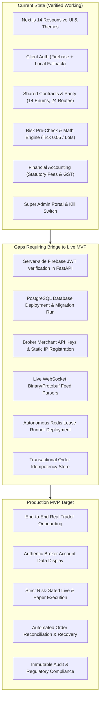

# MVP Gap Analysis & Readiness Assessment (mvp-gap-analysis.md)
## NIFTY Auto Trader 3.0 — Production-Oriented MVP

> **Assessment Date**: October 30, 2026  
> **Target Outcome**: Convert existing project into a genuinely functional, production-oriented MVP

---

## 1. Domain-by-Domain Gap Analysis

This gap analysis compares the **Current State** against the **Production-Oriented MVP Target** defined across Phases 1 through 15.

---

## 2. Detailed Gap Matrix

### 2.1 Authentication & User Management (Phase 1)
- **Current State**: Client uses Firebase Auth SDK (`apps/web/src/lib/firebase.ts`) with Google popup and email/password. Fallback preview session enables complete UI navigation. FastAPI router exists in `services/api/app/routers/auth.py`.
- **MVP Gap**:
  - FastAPI backend currently verifies JWTs using local secret; it needs to verify Firebase JWT tokens server-side using Firebase Admin SDK or Google public keys.
  - User profiles, broker connection preferences, and risk limits must be persisted to the PostgreSQL `users` and `user_profiles` tables.
- **Priority**: HIGH (Phase 1).

### 2.2 Canonical Multi-Broker Architecture (Phase 2 & Phase 3)
- **Current State**: 6 broker adapters (`KotakNeoAdapter`, `ZerodhaKiteAdapter`, `UpstoxAdapter`, `AngelOneAdapter`, `DhanAdapter`, `FyersAdapter`) exist in `services/api/app/broker/` implementing `BrokerAdapter`.
- **MVP Gap**:
  - Broker adapters currently contain standard mock/sandbox fallbacks when merchant credentials are missing.
  - To transition from `BLOCKED_EXTERNAL_SETUP` to `WORKING`:
    1. Register developer accounts with Zerodha Kite Connect, Upstox Developer, Kotak Neo, Angel One SmartAPI, DhanHQ, and Fyers.
    2. Register static egress IP addresses with brokers requiring static IP binding (Kotak Neo, Angel One, Dhan).
    3. Implement AES-256-GCM envelope encryption for storing customer API secrets.
- **Priority**: CRITICAL (Phase 2 & 3).

### 2.3 Live Dashboard & Market Data (Phase 4 & Phase 8)
- **Current State**: Dashboard renders account cash, margin, positions, orders, and P&L. Option chain displays strikes and simulated Greeks.
- **MVP Gap**:
  - WebSocket market tick parsers in `services/api` need direct socket binding to live broker feed endpoints:
    - Zerodha: Binary tick packets (Kite Ticker).
    - Upstox: Protobuf binary feed.
    - Angel One / Kotak: WebSockets with token authentication.
  - Feed staleness watchdog (<30s timeout) must trigger automatic reconnection with exponential backoff.
- **Priority**: HIGH (Phase 4 & 8).

### 2.4 Order Management & Safety Gates (Phase 5)
- **Current State**: Order state machine (13 states) implemented in `services/api/app/services/order_state_machine.py`. Front-end order ticket enforces tick size (0.05), lot size (25/50), and four-part live safety lock.
- **MVP Gap**:
  - Implement broker-side order status reconciliation daemon. When a network timeout occurs during `place_order()`, the system must never blindly retry; it must poll the broker's orderbook using `client_order_id` before marking the order state.
  - Implement postback webhook endpoints for asynchronous fill notifications.
- **Priority**: CRITICAL (Phase 5).

### 2.5 Centralized Risk Engine (Phase 6)
- **Current State**: Server-side risk engine (`services/api/app/services/execution_engine.py`) enforces max loss per trade, max daily loss, max lot quantity, and order frequency limits.
- **MVP Gap**:
  - Implement active position guard: If protective Stop-Loss Limit (SL-L) order placement fails at the broker, the system must immediately trigger an emergency alert, halt automated entries, and execute the configured safety recovery policy.
- **Priority**: CRITICAL (Phase 6).

### 2.6 Strategy Engine & Worker (Phase 7)
- **Current State**: Strategy definition builder, version management, and on-demand evaluation logic in `services/api/app/services/strategy_engine.py`.
- **MVP Gap**:
  - Background daemon (`services/trading_worker`) requires an active Redis cluster for distributed leader election (`SET resource_key token NX PX 10000`) and per-tenant execution leases.
  - Market hours calendar (`Asia/Kolkata`) must automatically suppress live execution on NSE exchange holidays and outside 09:15 to 15:30 IST.
- **Priority**: HIGH (Phase 7).

### 2.7 Trade Analytics & Accounting (Phase 9)
- **Current State**: Financial accounting engine (`services/api/app/services/financial_accounting.py`) calculates gross and net P&L with itemized statutory charges (STT, Exchange fees, SEBI charges, Stamp duty, GST).
- **MVP Gap**:
  - Reconcile broker tradebook records with internal fill records at end-of-day (EOD) to capture actual broker-billed charges versus calculated estimates.
- **Priority**: MEDIUM (Phase 9).

### 2.8 Notifications & System Health (Phase 10)
- **Current State**: In-app notifications and watchdog health banner implemented.
- **MVP Gap**:
  - Implement transactional email delivery (SendGrid / AWS SES) for critical security events (new broker connection, password change, emergency trading halt).
- **Priority**: MEDIUM (Phase 10).

---

## 3. Summary of External Blockers & Pre-Requisites

| Blocker ID | Domain | Requirement | Resolution Strategy |
| :--- | :--- | :--- | :--- |
| **BLK-01** | Broker APIs | Active merchant developer accounts for 6 brokers | Provide developer setup documentation and guided onboarding for users to input their own official API keys. |
| **BLK-02** | Network Egress | Dedicated Static Egress IP for Kotak Neo & Angel One | Document VPS / AWS Elastic IP deployment script (`infrastructure/deployment/`) to route outbound traffic through a fixed IP. |
| **BLK-03** | Database | Running PostgreSQL 16 instance | Deploy managed PostgreSQL (AWS RDS / Supabase / Neon) and run Alembic migrations. |
| **BLK-04** | Distributed Cache | Running Redis 7 instance | Deploy managed Redis (AWS ElastiCache / Upstash / Redis Cloud) for distributed locking. |
