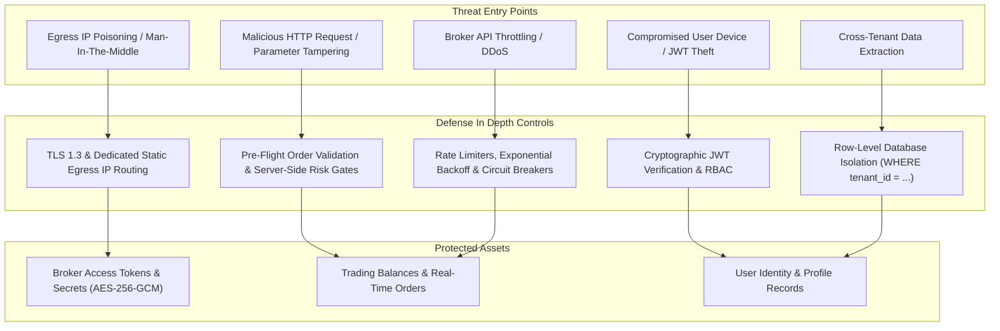
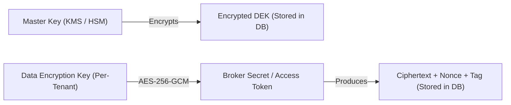

# Security Threat Model & Risk Analysis (security-threat-model.md)
## NIFTY Auto Trader 3.0 — Multi-Tenant Trading SaaS

> **Model Framework**: STRIDE & SEBI Cybersecurity Guidelines  
> **Target System**: AutoTrader 3.0 Web Application, API Gateway, and Trading Worker  
> **Date**: October 30, 2026

---

## 1. System Threat Model Overview

AutoTrader 3.0 handles financial data, broker API credentials, and autonomous order routing. A compromised system could cause severe financial loss, regulatory penalties, and reputational collapse.

---

## 2. STRIDE Threat Matrix & Mitigations

### 2.1 Spoofing (Identity Spoofing & Tenant Impersonation)
- **Threat**: An attacker supplies another trader's `tenant_id` or `user_id` in API headers or payloads to view balances or place unauthorized trades.
- **Severity**: CRITICAL.
- **Mitigations**:
  - The API Gateway strictly derives the user and tenant context from the cryptographically verified JWT token issued by the auth provider.
  - Client-supplied `tenant_id` query parameters and payload fields are ignored or rejected.
  - All database queries filter authoritatively on `session_context.tenant_id`.

### 2.2 Tampering (Order & Risk Parameter Tampering)
- **Threat**: An attacker intercepts order requests and alters quantity, price, or disables stop-loss limits before reaching the broker.
- **Severity**: CRITICAL.
- **Mitigations**:
  - End-to-end TLS 1.3 encryption across all communication channels.
  - Server-side pre-flight risk checks execute immediately before dispatch.
  - Client cannot bypass server risk limits (daily loss limit, max lots, tick size alignment).

### 2.3 Repudiation (Disputed Trades & Audit Denial)
- **Threat**: A user claims an order was submitted by the platform without authorization, or an admin denies executing a platform-wide kill switch.
- **Severity**: HIGH.
- **Mitigations**:
  - Immutable audit logs (`audit_logs` table) record every order intent, state transition, and admin action with UTC timestamps, user ID, client IP, and full audit reason.
  - Orders carry an immutable idempotency key (`tenant_id:client_order_id`).

### 2.4 Information Disclosure (Credential Leaks & Token Exposure)
- **Threat**: Broker API keys, access tokens, or TOTP seeds leak in web responses, browser logs, error stack traces, or version control.
- **Severity**: CRITICAL.
- **Mitigations**:
  - Broker credentials in PostgreSQL are encrypted using **AES-256-GCM envelope encryption** with customer-specific Data Encryption Keys (DEKs).
  - API responses strictly serialize via Pydantic schemas that redact secret fields (e.g., returning only masked strings `ak_live_••••••`).
  - Strict `.gitignore` prevents `.env` or credential files from entering git repositories.
  - Catch-all API proxy and `apiClient` sanitize error messages to prevent leaking stack traces or raw JSON parse tokens.

### 2.5 Denial of Service (Broker Flooding & Worker Lockout)
- **Threat**: High-frequency order generation exhausts broker rate limits, triggering broker API bans or locking execution threads.
- **Severity**: HIGH.
- **Mitigations**:
  - In-memory and Redis token bucket rate limiters throttle order requests per broker guidelines (e.g., 10 req/sec).
  - Order state machine implements an exponential backoff policy for throttled responses (HTTP 429).
  - Automatic circuit breaker trips if 3 consecutive network timeouts occur, transitioning the tenant runner into `RISK_LOCKED`.

### 2.6 Elevation of Privilege (Super Admin Bypass)
- **Threat**: A standard trader navigates to `/admin` or sends requests to `/api/v1/admin/*` to manipulate other tenants or change platform feature flags.
- **Severity**: CRITICAL.
- **Mitigations**:
  - Server-authorized role checks (`require_super_admin` dependency in FastAPI) enforce role validation on every single admin endpoint.
  - Front-end `/admin` routes check `user.role === 'super_admin'` before rendering.
  - Platform kill switch and user suspensions require mandatory logged operational justification.

---

## 3. Envelope Encryption Architecture for Broker Secrets

1. **Master Key**: Managed in Cloud KMS or secure environment vault; never stored in code or database.
2. **Data Encryption Key (DEK)**: Unique per tenant, rotated periodically.
3. **Ciphertext**: Stored in PostgreSQL with authenticated GCM tag. Decrypted only in-memory immediately prior to authenticating with the broker gateway.

---

## 4. Static-IP Isolation & Egress Rules

- In accordance with **Rule 20**: Unrelated traders' live order flow must never be routed through a shared static IP unless formally permitted by exchange and broker agreements.
- Multi-tenant deployments bind broker connections to dedicated worker nodes or proxy endpoints with distinct elastic static IPs.
